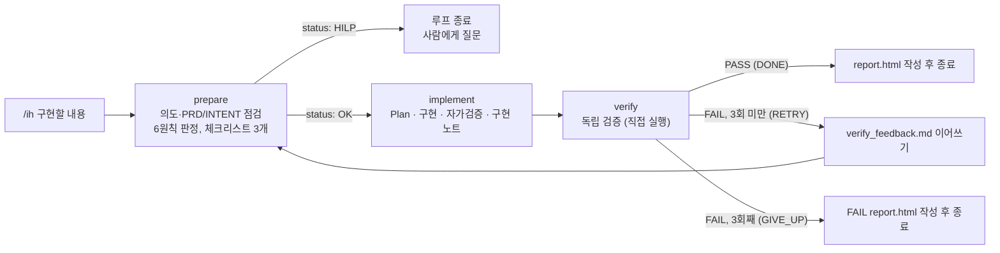

# /ih (Implement Harness) — 구현 하네스

`/ih {구현할 내용}` 한 번으로 **준비 → 구현 → 검증**을 돌리고, 검증이 실패하면 같은 Evidence 폴더로 **준비부터 다시** 시작하는 Inner Loop 워크플로입니다. 최대 3회까지 반복하고, 사람 확인(HILP)이 필요하거나 3회 안에 통과하지 못하면 멈추고 사람에게 보고합니다.

| 항목 | 내용 |
|---|---|
| 작성자 | 김현곤 |
| 작성일 | 2026-10-21 |
| 기준 문서 | `docs/PRD.md`, `docs/INTENT.md` (INTENT 3장 "변경할 때 지킬 것" 6원칙) |
| 문서 양식 | 팀 템플릿 `docs/loops/templates/precheck.html`, `report.html` (PR #11) |
| 상태 | **초안.** 설계와 사용 경험을 정리한 문서입니다. 한계는 [7. 알려진 한계](#7-알려진-한계)를 먼저 읽어 주세요 |

> **이 PR에는 이 README만 들어 있습니다.** `/ih` 를 이루는 파일은 `.claude/` 아래에 있고, 팀 `.gitignore` 가 `.claude` 를 제외해서 저장소에 올라가지 않습니다. 그대로 쓰려면 [8. 파일 위치](#8-파일-위치)의 파일을 각자 만들어야 합니다.

## 1. 한눈에 보기



- **사람 승인을 기다리지 않습니다.** prepare 가 `HILP` 를 반환할 때만 멈춥니다.
- 재시도에서도 **같은 Evidence 폴더**를 씁니다.
- Pass 조건은 **체크리스트 3개 통과 + `gradlew.bat test` 전체 통과 + 6원칙 위반 없음**입니다.

## 2. 사용법

```
/ih 주문 추가 화면에 발주사 정보(회사명 필수, 담당자 연락처 선택)를 입력받고, 확정 시 주문에 함께 저장해 주문 상세에서 보여 준다
```

- **개인 브랜치에서 실행합니다.** `main` 이면 implement 가 중단합니다.
- 요청은 **작고 구체적이며 목적이 드러나게** 씁니다. 막연하거나 커서 prepare 가 질문하면 HILP 로 멈춥니다.
- 필수/선택 여부, 저장 범위, 화면 표시처럼 **결정이 필요한 것은 요청에 적습니다.** 적지 않으면 prepare 가 추론하고, 그 추론을 사람이 확정해야 합니다.
- 이미 실패하는 테스트가 있으면 prepare 가 "심각한 위험"으로 보고 HILP 가 될 수 있습니다.
- `/ih` 한 번에 테스트가 최소 2번(prepare 의 기준선, verify) 돕니다. 재시도하면 더 돕니다.

### 끝났을 때 결과 읽는 법
| status | 의미 | 할 일 |
|---|---|---|
| `pass` | N회차에 통과, `report.html` 있음 | 리포트를 보고 **완료 승인은 사람이** 합니다 (사람 확인 칸은 비어 있음) |
| `hilp` | prepare 가 질문과 함께 멈춤 (Evidence 폴더와 `precheck.html` 은 만들어져 있음) | 질문에 답하는 내용을 요청에 반영해 다시 `/ih` |
| `failed` | 3회 모두 실패, FAIL `report.html` 있음 | `report.html` 과 `verify_feedback.md` 의 원인을 보고 요청을 고치거나 직접 수정 |
| `error` | 요청이 비었거나, 개인 브랜치가 아니거나, 에이전트 오류 | 메시지를 보고 조건을 고친 뒤 다시 실행 |

## 3. 단계별 역할

### prepare — 준비 (`.claude/agents/prepare.md`)
구현 **전에** 요청을 점검하고, 구현 후 확인할 체크리스트를 정합니다. 구현은 하지 않습니다.

1. **의도 점검**: 배경(어떤 상황)과 목적(왜 필요)을 이해했는지 봅니다. 읽어낸 근거는 `요청` / `PRD` / `추론` 으로 표시합니다.
2. **기준 문서 점검**: `docs/PRD.md`, `docs/INTENT.md` 를 **먼저 읽고** 관련 FR 을 찾습니다. INTENT 3장 **6원칙 각각**을 `영향 없음 / 주의 / 위반` 으로 판정하고, INTENT 4장 표로 영향 범위를 정리하며, 기준선 테스트를 1회 실행합니다.
3. **리뷰 수준(초안 기준)**: Green(영향 한두 곳, 6원칙 모두 영향 없음) / Yellow(여러 곳 또는 "주의" 있음) / Red(위반, 열린 질문 결정 필요, 거대한 변경, 되돌릴 수 없는 작업, 기준선 이미 실패).
4. **HILP 판단**: 아래 중 하나라도 해당하면 `status: HILP` 로 반환하고, **답해야 할 질문을 구체적으로** 적습니다.
   - 배경 또는 목적을 이해하지 못했을 때
   - 너무 거대한 변경이거나 심각한 위험이 있는데 사용자가 모르는 듯할 때 (경고 포함)
   - PRD 10장 열린 질문 Q1~Q4, INTENT 6장 Q1~Q4, PRD 결함 후보의 결정이 필요한 요청일 때
   - 6원칙 중 하나라도 "위반" 일 때
5. **체크리스트 3개**: 구현 후 반드시 확인할 것 3개. 6원칙 "주의" 항목을 우선 반영합니다.
6. **산출물**: `checklist.md`(체크리스트 3개와 6원칙 판정만 간단히)와 `precheck.html`(팀 템플릿). **HILP 여도 둘 다 만듭니다.**

**재시도일 때**: `verify_feedback.md` 를 가장 먼저 읽고(가장 아래 = 최근 시도 절 중심) 실패 원인을 반영해 다시 점검합니다. 체크리스트는 기본적으로 유지하고, **더 느슨하게 바꾸지 않습니다**(고치면 이유를 `precheck.html` 8장에 기록).

### implement — 구현 (`.claude/agents/implement.md`)
Plan → 구현 → 자가검증 → 구현 노트.

- 시작 전: `main` 이면 중단. `checklist.md` 와 `precheck.html` 6장을 읽고, 6원칙 "주의" 항목을 특히 신경 씁니다. 재시도면 `verify_feedback.md` 를 먼저 읽습니다.
- 산출물(Evidence 폴더): `plan.md`, `self-check.md`, **`implement_notes.md`**.
- `implement_notes.md`: 변경 파일과 한 줄 요약, 선택한 방식과 이유, `checklist.md` 각 항목을 어떻게 만족시켰다고 생각하는지. **재시도에서는 기존 내용 아래에 `## 시도 n/3` 으로 이어 씁니다.** 이 노트는 구현자의 "주장"입니다.
- 커밋·푸시를 하지 않습니다. `precheck.html`, `checklist.md`, `report.html` 은 고치지 않습니다.

### verify — 독립 검증 (`.claude/agents/verify.md`)
구현과 **별개의 새 컨텍스트**에서 동작합니다.

- **원칙**: implement 의 자가검증을 믿지 않습니다. 판정 근거는 **실제 코드, `git diff`, 직접 실행한 테스트 출력**뿐입니다. `implement_notes.md` 와 `self-check.md` 는 참고만 합니다.
- **검증 행**: `CK-1`, `CK-2`, `CK-3`(체크리스트), `AC-T`(`gradlew.bat test` 전체), `AC-P`(6원칙, "주의" 항목은 `git diff` 로 실제로 지켜졌는지 확인).
- **판정**: 모든 행이 `pass` 일 때만 `PASS`. `fail` 이나 `skip`(검증 못 함)이 하나라도 있으면 `FAIL` 입니다.
- **`next` 반환값**: `DONE`(통과, 종료) / `RETRY`(prepare 로 복귀) / `GIVE_UP`(최종 회차 실패, 종료).
- **실패 시**: `verify_feedback.md` 에 `## 시도 n/3` 을 붙여 **이어서** 기록합니다(덮어쓰지 않음). 실패한 항목, 실패 근거(테스트 출력 또는 diff 위치), 고칠 방향 제안.
- **`report.html`**: **통과했을 때, 또는 최대 횟수를 넘겨 종료될 때(FAIL report)** 만 씁니다. 중간 실패에서는 만들지 않습니다. 4장 반복 기록은 `verify_feedback.md` 이력에서 모읍니다.
- AI 는 **사람 확인(HITL) 칸을 채우지 않습니다.** (precheck 9장, report 8장)

## 4. Evidence 폴더 (`docs/evidence/김현곤/TASK-번호-작업명/`)

| 파일 | 만드는 단계 | 용도 |
|---|---|---|
| `checklist.md` | prepare | **에이전트가 읽는 용도.** 체크리스트 3개 + 6원칙 판정 |
| `precheck.html` | prepare | 사람이 읽는 사전 검토. 6장 통과 기준 = `CK-1~3`, `AC-T`, `AC-P` |
| `plan.md`, `self-check.md` | implement | 계획, 자가검증 결과 |
| `implement_notes.md` | implement | 구현 노트(시도별 이어쓰기) |
| `verify_feedback.md` | verify (FAIL 일 때) | 시도별 실패 기록. 다음 회차 prepare 가 가장 먼저 읽음 |
| `report.html` | verify (통과 또는 최종 실패) | 검증 리포트. 3장 표가 6장 행과 1:1 |

작업 번호는 `docs/evidence/김현곤/` 아래 기존 `TASK-숫자-…` 폴더의 다음 번호(`TASK-001` 부터), 작업명은 요청에서 만든 짧은 영어 이름입니다. **이 폴더는 로컬 생성물이라 기본적으로 커밋하지 않습니다.**

## 5. 워크플로 동작 규칙 (`.claude/workflows/ih.js`)

- prepare 와 verify 는 **구조화된 값**을 반환합니다. 복귀·종료 판단은 스크립트가 회차 수로 직접 하고, verify 의 `next` 는 교차 확인용입니다.
- prepare 반환: `status`(OK/HILP/ERROR), `evidencePath`(OK·HILP 모두 포함), `reviewLevel`, `questions`, `warnings`, `message`.
- verify 반환: `result`(PASS/FAIL), `next`, `failedItems`, `summary`, `feedbackPath`, `reportPath`, `reportWritten`.
- verify 가 응답하지 않거나 `FAIL` 인데 `next: DONE` 처럼 모순되면 **실패로 처리**하고 재시도합니다.
- 최종 회차(3회째)에 실패했는데 `report.html` 작성이 보고되지 않으면, verify 를 **"보고서만 작성" 모드**로 한 번 더 부릅니다(테스트 재실행 없이 `verify_feedback.md` 로 FAIL report 작성).
- implement 가 `오류…` 를 반환하면(예: 개인 브랜치가 아님) 다시 돌려도 같은 결과라 **재시도하지 않고** 중단합니다.
- 재시도에서 prepare 가 다른 Evidence 경로를 반환해도 **처음 폴더를 고수**합니다.

## 6. 검증 상태 (확인한 것 / 확인하지 못한 것)

**확인한 것**
- 워크플로 스크립트의 흐름을 **가짜 응답**으로 16개 시나리오·27개 확인 항목에서 시험했습니다 (1회 통과, 재시도 후 통과, 3회 실패, 최종 회차 FAIL report, 보고서만 작성 모드, HILP, 재시도 중 HILP, 오류 처리 등). 이 시험 스크립트는 저장소에 없습니다.
- **실제 에이전트 실행**: 새 정의(prepare 점검, `checklist.md`, 구현 노트, verify 직접 검증)로 `/ih` 를 1번 돌렸습니다. 요청은 "주문 시 발주사 정보를 텍스트로 입력하도록". 1회차에 통과했고, 산출물(체크리스트 3개, `report.html` 의 5개 행 모두 pass, 요약 타일 5/5, HITL 칸 비어 있음)이 설계대로 만들어진 것을 확인했습니다. 단위 테스트 24개 통과도 직접 재확인했습니다.

**확인하지 못한 것**
- **재시도 경로(verify FAIL → `verify_feedback.md` → prepare 복귀)와 FAIL `report.html`, prepare 의 HILP 는 실제 에이전트로 돌려 보지 못했습니다.** 가짜 응답 시험만 했습니다.
- 위 실제 실행에서 prepare 는 HILP 를 반환하지 않았습니다. 요청이 모호했는데도 필수/선택을 "추론"으로 정하고 진행했습니다.

## 7. 알려진 한계

1. **E2E 테스트는 Pass 조건에 없습니다.** Pass 는 `gradlew.bat test`(단위·MockMvc)만 봅니다. 위 실제 실행의 결과물(발주사를 **필수** 입력으로 구현)은 단위 테스트를 통과했지만, `main` 에 있는 **Playwright E2E 22개를 깨뜨렸습니다**(주문 확정 시 `발주사를 입력하세요` 로 거부됨). `/ih` 는 이를 잡지 못했고, prepare 가 "필수로 할지"를 HILP 로 묻지도 않았습니다. 보완 방안: ① prepare 의 영향 범위에 "E2E 영향"을 넣거나 ② 통과 조건에 E2E 실행을 포함.
2. **판정 기준은 초안입니다.** 리뷰 수준 기준, "거대한 변경", "사용자가 모르는 듯함"(요청 문장에 위험이 드러나지 않으면 모름으로 봄)은 임의로 정한 값이라 팀 합의가 필요합니다.
3. **verify 의 제한은 지침으로만 걸려 있습니다.** `Bash` 는 실행·조회 전용, 쓰기는 `report.html` 과 `verify_feedback.md` 두 파일뿐이라고 지시했지만 도구 수준의 강제는 아닙니다.
4. **팀 템플릿의 결함을 우회하고 있습니다.** `report.html` 의 "충족한 통과 기준" 분모가 모든 행을 세는 점은 검증 표를 전부 6장의 행으로 맞춰 피했고, "반복 횟수" 칸은 스크립트가 세지 않아 verify 가 직접 적습니다. 템플릿 자체는 고치지 않았습니다.
5. **정의 변경은 새 세션이나 `/reload-skills` 가 있어야 반영됩니다.** 에이전트·워크플로 정의를 고친 뒤 같은 세션에서 `/ih` 를 돌리면 이전 버전으로 돕니다(안내 문구에 `verify_feedback.md` 가 보이는지로 구분).
6. **환경 의존**: Windows 에서 Tomcat 임시 폴더(`%TEMP%\<해시>`)가 `Administrators` 소유로 남아 있으면 앱이 시작되지 않습니다(`is not owned by …`). 코드와 무관한 환경 문제이며, 테스트 서버의 임시 경로를 바꿔 우회할 수 있습니다.
7. **`/ih` 의 결과물은 사람이 승인하기 전에는 완료가 아닙니다.** 코드 변경은 로컬 작업 트리에 남고 커밋되지 않습니다.

## 8. 파일 위치

| 파일 | 역할 | 저장소 |
|---|---|---|
| `.claude/workflows/ih.js` | `/ih` 동적 워크플로 (`commands/` 에 두지 않음) | 올라가지 않음 (`.claude` 제외) |
| `.claude/agents/prepare.md` | 준비 에이전트 | 올라가지 않음 |
| `.claude/agents/implement.md` | 구현 에이전트 | 올라가지 않음 |
| `.claude/agents/verify.md` | 검증 에이전트 | 올라가지 않음 |
| `docs/loops/templates/precheck.html`, `report.html` | 팀 공통 문서 양식 (prepare·verify 가 복사해 채움, 원본은 수정하지 않음) | 올라가 있음 (PR #11) |
| `docs/evidence/김현곤/` | 실행 결과 | 로컬 생성물 (커밋 안 함) |

`.claude/` 파일을 팀과 공유하려면 저장소 규칙(`.gitignore` 의 `.claude`)을 어떻게 할지 먼저 정해야 합니다. 이 문서는 그 논의를 위한 설명입니다.

## 9. 열린 질문

- 통과 조건에 **E2E 실행**을 포함할지 (현재 단위·MockMvc 만).
- 리뷰 수준과 HILP 판정 기준을 팀 기준으로 어떻게 확정할지.
- `.claude/` 의 워크플로·에이전트 정의를 팀이 공유할 방법 (저장소에 올릴지, 별도 위치에 둘지).
- verify 가 쓸 수 있는 도구를 도구 수준에서 제한할 방법 (현재는 지침).
