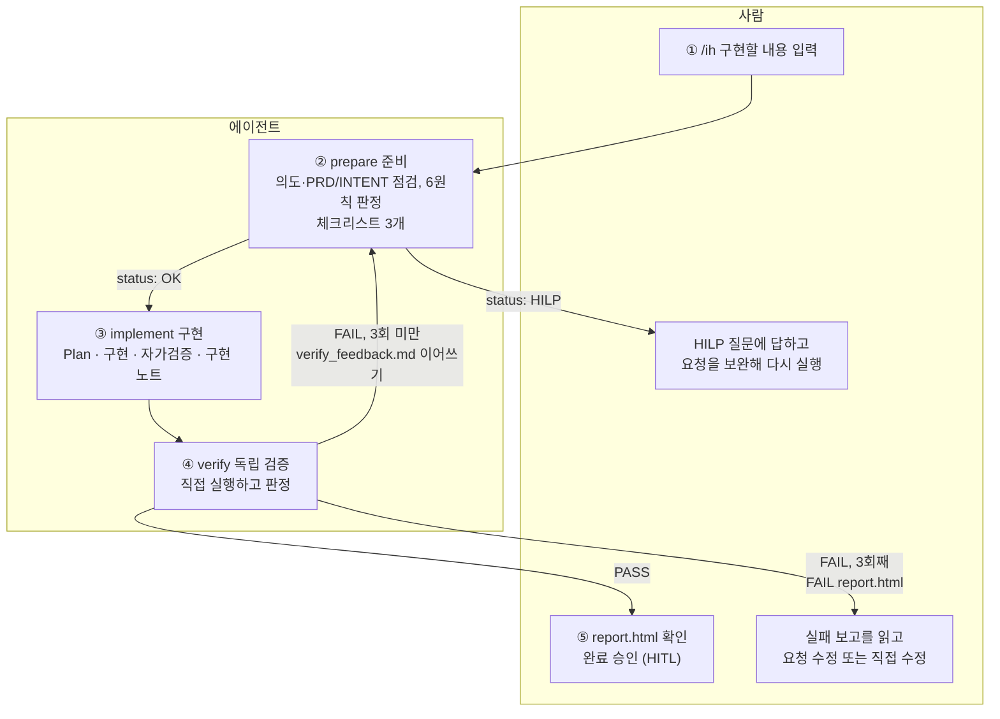

# /ih (Implement Harness) 동작 설명

`/ih {구현할 내용}` 은 **준비 → 구현 → 검증**을 에이전트 세 개가 차례로 수행하는 구현 하네스입니다. 검증이 실패하면 같은 Evidence 폴더로 준비부터 다시 시작하고(최대 3회), 사람의 판단이 필요하거나 3회 안에 통과하지 못하면 멈추고 사람에게 넘깁니다.

이 문서는 **loop 가 어떤 단계로 이루어져 있는지, 단계마다 에이전트가 무엇을 하는지, 사람이 무엇을 해야 하는지**를 설명합니다.

| 항목 | 내용 |
|---|---|
| 작성자 / 작성일 | 김현곤 / 2026-10-21 |
| 기준 문서 | `docs/PRD.md`, `docs/INTENT.md` (INTENT 3장 "변경할 때 지킬 것" 6원칙) |
| 문서 양식 | 팀 템플릿 `docs/loops/templates/precheck.html`, `report.html` (PR #11) |
| 상태 | 초안. 한계는 [7장](#7-알려진-한계)을 먼저 읽어 주세요 |

> **이 PR 은 이 README 한 파일만 담고 있습니다.** `/ih` 를 이루는 파일은 `.claude/` 아래에 있고, 팀 `.gitignore` 가 `.claude` 를 제외해서 저장소에 올라가지 않습니다([8장](#8-파일-위치)).

## 1. 한눈에 보기

핵심 규칙
- **사람 승인을 기다리지 않습니다.** prepare 가 `HILP` 를 반환할 때만 멈춥니다.
- 재시도에서도 **같은 Evidence 폴더**를 씁니다 (`docs/evidence/김현곤/TASK-번호-작업명/`).
- **Pass 조건**: 체크리스트 3개 통과 + `gradlew.bat test` 전체 통과 + 6원칙 위반 없음.
- 각 에이전트는 **서로 독립된 컨텍스트**에서 동작하고, 파일(Evidence 폴더)로 일을 넘깁니다.

## 2. 단계 요약

| 단계 | 누가 | 입력 | 하는 일 | 산출물 | 다음 |
|---|---|---|---|---|---|
| ① 요청 | **사람** | — | 구현할 내용을 한 문장으로 `/ih` 에 입력 | — | prepare |
| ② 준비 | **prepare** | 요청 | 의도 점검, PRD/INTENT 점검, 6원칙 판정, 리뷰 수준, 체크리스트 3개 | `checklist.md`, `precheck.html` | OK → implement / HILP → **사람** |
| ③ 구현 | **implement** | 요청, Evidence 폴더 | Plan → 구현 → 자가검증 → 구현 노트 | `plan.md`, `self-check.md`, `implement_notes.md`, 코드 변경 | verify |
| ④ 검증 | **verify** | 요청, Evidence 폴더, 회차 | 체크리스트·`git diff`·테스트를 직접 확인하고 판정 | 실패: `verify_feedback.md` / 통과·최종 실패: `report.html` | PASS → **사람** / FAIL → prepare / 3회째 FAIL → **사람** |
| ⑤ 승인 | **사람** | `report.html` | 결과 확인, 완료 승인(HITL), 커밋 | — | 끝 |

## 3. 단계별 상세 — 에이전트가 하는 일

### ② prepare (`.claude/agents/prepare.md`)
구현 **전에** 요청을 점검하고 구현 후 확인할 것을 정합니다. **구현은 하지 않습니다.**

1. **의도 점검**: 배경(어떤 상황)과 목적(왜 필요)을 이해했는지 봅니다. 읽어낸 근거는 `요청` / `PRD` / `추론` 으로 표시합니다.
2. **기준 문서 점검**: `docs/PRD.md`, `docs/INTENT.md` 를 **먼저 읽고** 관련 FR 을 찾습니다.
   - INTENT 3장 6원칙 **각각**을 `영향 없음 / 주의 / 위반` 으로 판정합니다.
   - INTENT 4장 "함께 확인할 곳" 표로 영향 범위를 정리합니다.
   - 기준선 테스트(`gradlew.bat test` 전체)를 1회 실행합니다.
3. **리뷰 수준 판정**(초안 기준): **Green**(영향 한두 곳, 6원칙 모두 영향 없음) / **Yellow**(여러 곳이거나 "주의" 있음) / **Red**(위반, 열린 질문 결정 필요, 거대한 변경, 되돌릴 수 없는 작업, 기준선이 이미 실패).
4. **HILP 판단**: 아래 중 하나라도 해당하면 `status: HILP` 로 멈추고, **사람이 답해야 할 질문을 구체적으로**(상황·선택지·결과) 적습니다.
   - 배경 또는 목적을 이해하지 못했을 때
   - 너무 거대한 변경이거나 심각한 위험이 있는데 사용자가 모르는 듯할 때 (경고 포함)
   - PRD 10장 열린 질문 Q1~Q4, INTENT 6장 Q1~Q4, PRD 결함 후보의 **결정이 필요한** 요청일 때
   - 6원칙 중 하나라도 "위반" 일 때
5. **체크리스트 3개**: 구현 후 반드시 확인할 것 3개를 정합니다. 6원칙 "주의" 항목을 우선 반영합니다.
6. **산출물**: `checklist.md`(체크리스트 3개와 6원칙 판정만 간단히, **에이전트가 읽는 용도**)와 `precheck.html`(팀 템플릿, **사람이 읽는 용도**). **HILP 여도 둘 다 만듭니다.**

**재시도로 돌아왔을 때**: `verify_feedback.md` 를 가장 먼저 읽고(가장 아래 = 최근 시도 절 중심) 실패 원인을 반영해 다시 점검합니다. 체크리스트는 기본 유지하고 **더 느슨하게 바꾸지 않습니다**(고치면 이유를 `precheck.html` 8장에 기록).

### ③ implement (`.claude/agents/implement.md`)
Plan → 구현 → 자가검증 → 구현 노트 순서로 진행합니다.

1. **시작 전 점검**: 현재 브랜치가 `main` 이면 중단합니다. `checklist.md` 와 `precheck.html` 6장을 읽고, 6원칙 "주의" 항목을 특히 신경 씁니다. 재시도면 `verify_feedback.md` 를 먼저 읽습니다.
2. **Plan** → `plan.md`: 요청 이해, 바꿀 파일과 이유, 영향받는 FR/원칙, 만들 테스트, 불확실한 점. 요청이 PRD/INTENT 와 충돌하면 구현하지 않고 충돌 내용을 반환합니다.
3. **구현**: 계획한 범위만 바꿉니다. 6원칙을 어기지 않습니다.
4. **자가검증** → `self-check.md`: 테스트 전체 실행, 6원칙 점검, 체크리스트 행별 자가 점검.
5. **구현 노트** → `implement_notes.md`: 변경 파일과 한 줄 요약, 선택한 방식과 이유, `checklist.md` 각 항목을 어떻게 만족시켰다고 생각하는지. **재시도에서는 기존 내용 아래에 `## 시도 n/3` 으로 이어 씁니다.**

implement 의 자가검증과 구현 노트는 **구현자의 주장**입니다. 통과 여부는 verify 가 따로 판정합니다.

### ④ verify (`.claude/agents/verify.md`)
구현과 **별개의 새 컨텍스트**에서 동작하는 독립 검증자입니다.

- **원칙**: implement 의 자가검증을 믿지 않습니다. 판정 근거는 **실제 코드, `git diff`, 직접 실행한 테스트 출력**뿐입니다. `implement_notes.md` 와 `self-check.md` 는 어디를 볼지 짐작하는 참고용입니다.
- **검증 행**: `CK-1`, `CK-2`, `CK-3`(체크리스트 각 항목을 코드와 `git diff` 로 확인), `AC-T`(`gradlew.bat test` 전체 실행), `AC-P`(6원칙, "주의" 항목은 `git diff` 로 실제로 지켜졌는지 확인).
- **판정**: 모든 행이 `pass` 일 때만 `PASS`. `fail` 이나 `skip`(검증하지 못함)이 하나라도 있으면 `FAIL` 입니다.
- **FAIL 이고 3회 미만**: `verify_feedback.md` 에 `## 시도 n/3` 을 붙여 **이어서** 기록(덮어쓰지 않음)하고 `RETRY` 를 반환합니다. 기록 내용은 실패한 항목, 실패 근거(테스트 출력 또는 diff 위치), 고칠 방향 제안입니다. `report.html` 은 만들지 않습니다.
- **PASS**: `report.html` 을 작성하고 `DONE` 을 반환합니다.
- **FAIL 이고 3회째**: `verify_feedback.md` 에 이어 쓰고 **FAIL `report.html`** 도 작성한 뒤 `GIVE_UP` 을 반환합니다. 워크플로가 report 작성 여부를 확인하고, 없으면 verify 를 "보고서만 작성" 모드로 한 번 더 부릅니다.
- `report.html` 4장 반복 기록은 `verify_feedback.md` 에 쌓인 이력에서 모읍니다.

## 4. 사람이 하는 일

`/ih` 는 중간에 사람의 승인을 기다리지 않습니다. 그래서 **사람의 일은 시작 전, HILP 가 났을 때, 끝난 뒤**에 있습니다.

| 시점 | 사람이 하는 일 | 이유 |
|---|---|---|
| **실행 전** | 개인 브랜치인지 확인한다 (`main` 이면 implement 가 중단) | 루프의 변경은 개인 브랜치에 모이게 한다 |
| | 요청을 **작고 구체적으로, 목적이 드러나게** 쓴다. 필수/선택, 저장 범위, 화면 표시처럼 **결정이 필요한 것은 요청에 적는다** | 적지 않으면 prepare 가 추론하고, 그 추론을 사람이 확정해야 한다 |
| | 기존 테스트가 통과하는 상태인지, 작업 트리에 **관련 없는 변경이 남아 있지 않은지** 본다 | 기준선 실패는 "심각한 위험"이 되고, 관련 없는 변경은 verify 의 `git diff` 판정에 섞일 수 있다 |
| **실행 중** | 기다린다. 승인할 것이 없다 | prepare 가 HILP 를 반환할 때만 멈춘다 |
| **HILP 로 멈췄을 때** | 보고서의 **리뷰 수준, 경고, 질문**을 읽고 답을 정한다. 답을 **요청에 반영해 `/ih` 를 다시 실행**한다. `precheck.html` 8장에 같은 내용이 있다 | 열린 질문·6원칙 위반·불명확한 목적은 사람이 결정할 일이다 |
| **통과(`pass`) 후** | `report.html` 을 열어 결과를 확인한다. 변경된 코드를 **직접 리뷰**한다 | 통과는 체크리스트·테스트·6원칙에 대한 판정이지 사람의 승인이 아니다 |
| | `report.html` 8장 **사람 확인(HITL)** 의 체크박스, 결정, 확인한 사람, 의견을 **직접 채운다** | 완료 승인은 사람의 몫이다 |
| | 변경을 **커밋하고 PR 을 만든다** | 에이전트는 커밋·푸시를 하지 않는다 |
| **실패(`failed`, 3회) 후** | FAIL `report.html` 과 `verify_feedback.md` 를 읽고, 같은 문제가 반복됐는지, 요청이나 PRD/INTENT 가 모호한지 판단한다. 요청을 고쳐 다시 `/ih` 를 실행하거나 직접 수정한다 | 3회 안에 해결하지 못한 것은 사람이 개입해야 한다 |
| **오류(`error`)** | 메시지를 보고 조건(요청 비어 있음, 개인 브랜치 아님 등)을 고친 뒤 다시 실행한다 | 다시 돌려도 같은 결과인 오류는 재시도하지 않는다 |

### 에이전트가 하지 않는 일 (사람의 몫으로 남기는 것)
- **HITL 칸을 채우지 않습니다** (`precheck.html` 9장, `report.html` 8장). `precheck.html` 의 "검토 상태" 는 `자동 진행` 으로 기록됩니다. 구현 착수 승인을 기다리지 않기 때문입니다.
- **커밋·푸시·PR 생성을 하지 않습니다.**
- **`docs/PRD.md`, `docs/INTENT.md`, 팀 템플릿을 수정하지 않습니다.**
- 열린 질문(PRD Q1~Q4, INTENT Q1~Q4)을 **임의로 결정하지 않습니다.** 결정이 필요하면 HILP 입니다.
- 재시도에서 체크리스트를 **느슨하게 바꿔 통과시키지 않습니다.**

## 5. 실행 결과(status)와 흐름

| status | 언제 | 에이전트 호출 | 남는 파일 | 사람이 할 일 |
|---|---|---|---|---|
| `pass` (1회차) | 처음에 통과 | prepare → implement → verify | `checklist.md`, `precheck.html`, `plan.md`, `self-check.md`, `implement_notes.md`, `report.html` | 리뷰·HITL 기록·커밋 |
| `pass` (재시도 후) | N회차에 통과 | (prepare → implement → verify) × N | 위 + `verify_feedback.md`(이전 실패 이력) | 위와 같음 |
| `hilp` | prepare 가 사람 판단이 필요하다고 판정 | prepare 만 | `checklist.md`, `precheck.html` (질문·경고는 8장) | 질문에 답해 요청을 보완하고 다시 실행 |
| `failed` | 3회 모두 verify FAIL | (prepare → implement → verify) × 3, 필요하면 verify 한 번 더(보고서만 작성) | 위 + FAIL `report.html` | 원인 판단 후 요청 수정 또는 직접 수정 |
| `error` | 요청이 비었거나 개인 브랜치가 아님, 에이전트 오류 | 중단된 단계까지 | 단계에 따라 다름 | 조건을 고치고 다시 실행 |

## 6. Evidence 폴더 (`docs/evidence/김현곤/TASK-번호-작업명/`)

| 파일 | 만드는 쪽 | 읽는 쪽 | 용도 |
|---|---|---|---|
| `checklist.md` | prepare | implement, verify | 체크리스트 3개와 6원칙 판정. **에이전트용** |
| `precheck.html` | prepare | 사람 | 사전 검토. 6장 통과 기준 = `CK-1~3`, `AC-T`, `AC-P` |
| `plan.md`, `self-check.md` | implement | 사람 | 계획과 자가검증 결과 |
| `implement_notes.md` | implement | 사람 (verify 는 참고만) | 구현 노트. 시도별 이어쓰기 |
| `verify_feedback.md` | verify (FAIL 일 때) | prepare, implement | 시도별 실패 기록. 다음 회차가 가장 먼저 읽음 |
| `report.html` | verify (통과 또는 최종 실패) | 사람 | 검증 리포트. 3장 표가 6장 행과 1:1 |

작업 번호는 `docs/evidence/김현곤/` 아래 기존 `TASK-숫자-…` 폴더의 다음 번호(`TASK-001` 부터), 작업명은 요청에서 만든 짧은 영어 이름입니다. **이 폴더는 로컬 생성물이라 기본적으로 커밋하지 않습니다.**

## 7. 알려진 한계

1. **E2E 테스트는 Pass 조건에 없습니다.** Pass 는 `gradlew.bat test`(단위·MockMvc)만 봅니다. 실제로 "주문 시 발주사를 입력하도록" 요청을 돌렸을 때, 결과물(발주사를 **필수** 입력으로 구현)은 단위 테스트를 통과했지만 `main` 의 **Playwright E2E 22개를 깨뜨렸습니다**(주문 확정이 `발주사를 입력하세요` 로 거부됨). `/ih` 가 이를 잡지 못했고, prepare 가 "필수로 할지"를 HILP 로 묻지도 않았습니다.
2. **재시도 경로, FAIL `report.html`, prepare 의 HILP 는 실제 에이전트로 돌려 보지 못했습니다.** 워크플로 흐름은 가짜 응답으로 16개 시나리오·27개 항목을 시험했고(저장소에 없음), 실제 에이전트 실행은 1회(1회차 통과)입니다. 그 실행에서 산출물(체크리스트 3개, `report.html` 의 5개 행 모두 pass, HITL 칸 비어 있음)은 설계대로 만들어졌습니다.
3. **판정 기준은 초안입니다.** 리뷰 수준, "거대한 변경", "사용자가 모르는 듯함"(요청 문장에 위험이 드러나지 않으면 모름으로 봄)은 임의로 정한 값이라 팀 합의가 필요합니다.
4. **verify 의 제한은 지침으로만 걸려 있습니다.** `Bash` 는 실행·조회 전용, 쓰기는 `report.html` 과 `verify_feedback.md` 두 파일뿐이라고 지시했지만 도구 수준의 강제는 아닙니다.
5. **팀 템플릿의 결함을 우회하고 있습니다.** `report.html` 의 "충족한 통과 기준" 분모가 모든 행을 세는 점은 검증 표를 전부 6장의 행으로 맞춰 피했고, "반복 횟수" 칸은 verify 가 직접 적습니다. 템플릿 자체는 고치지 않았습니다.
6. **정의를 고친 뒤에는 새 세션이나 `/reload-skills` 가 필요합니다.** 같은 세션에서 `/ih` 를 돌리면 이전 버전으로 돕니다(안내 문구에 `verify_feedback.md` 가 보이는지로 구분).
7. **Windows 환경 의존**: Tomcat 임시 폴더(`%TEMP%\<해시>`)가 `Administrators` 소유로 남아 있으면 앱이 시작되지 않습니다(`is not owned by …`). 코드와 무관한 환경 문제이며 테스트 서버의 임시 경로를 바꿔 우회할 수 있습니다.

## 8. 파일 위치

| 파일 | 역할 | 저장소 |
|---|---|---|
| `.claude/workflows/ih.js` | `/ih` 동적 워크플로 (`commands/` 에 두지 않음) | 올라가지 않음 (`.claude` 제외) |
| `.claude/agents/prepare.md` | 준비 에이전트 | 올라가지 않음 |
| `.claude/agents/implement.md` | 구현 에이전트 | 올라가지 않음 |
| `.claude/agents/verify.md` | 검증 에이전트 | 올라가지 않음 |
| `docs/loops/templates/precheck.html`, `report.html` | 팀 공통 문서 양식. prepare·verify 가 복사해 채우며 원본은 수정하지 않음 | 올라가 있음 (PR #11) |
| `docs/evidence/김현곤/` | 실행 결과 | 로컬 생성물 (커밋 안 함) |

## 9. 열린 질문

- 통과 조건에 **E2E 실행**을 포함할지 (현재는 단위·MockMvc 만).
- 리뷰 수준과 HILP 판정 기준을 팀 기준으로 어떻게 확정할지.
- `.claude/` 의 워크플로·에이전트 정의를 팀이 공유할 방법 (저장소에 올릴지, 별도 위치에 둘지).
- verify 가 쓸 수 있는 도구를 도구 수준에서 제한할 방법 (현재는 지침).
