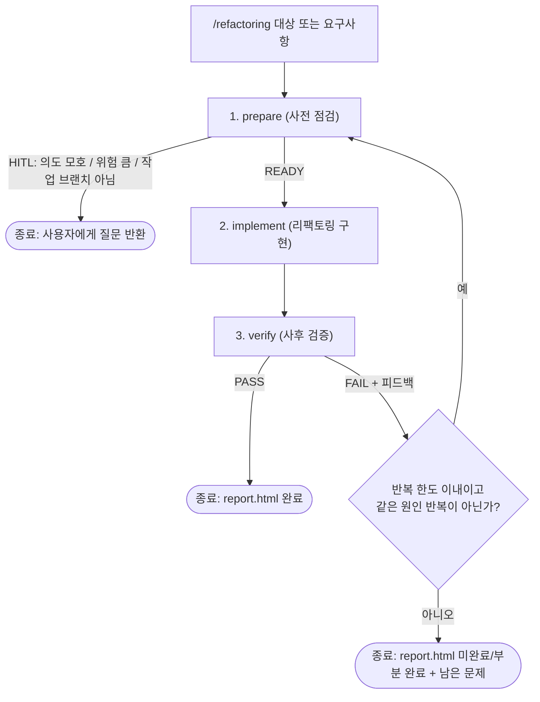

# Loop 설계: 안전한 리팩토링 (`/refactoring`)

> 작성자: 문형석 · 상태: **설계 초안** (구현 전) · 팀 공통 템플릿(`docs/loops/templates/`) 반영
> 이 문서는 Loop의 **설계 설명**만 담습니다. 에이전트 정의와 워크플로우 코드는 제출 대상이 아닙니다.

## 1. 한 줄 요약

리팩토링 요청이 들어오면 **구현 전에 위험을 점검하고(prepare) → 구현하고(implement) → 구현 후에 검증해서(verify)**, 검증에 실패하면 피드백을 들고 처음부터 다시 점검하는 Loop입니다. 이해가 부족하거나 위험이 크면 구현하지 않고 **사람에게 질문하고 멈춥니다(HITL)**. 점검과 검증의 증거는 팀 공통 템플릿을 채운 `precheck.html`, `report.html`로 남깁니다.

## 2. 왜 이런 Loop가 필요한가

리팩토링은 "동작은 그대로, 구조만 개선"이 약속인데, 약속이 지켜졌는지 눈으로만 확인하기 어렵습니다. 이 Loop는 그 약속을 **구현 전 통과 기준(AC)을 먼저 정하고, 구현 후에 그 기준을 하나씩 대조한 증거**로 남기게 합니다.

- 구현 전: 무엇을, 왜, 어떤 위험을 감수하며 바꾸는지와 "끝났다"의 기준을 먼저 정한다.
- 구현 후: 실제로 실행한 테스트 결과와 변경 내용을 기준과 1:1로 대조한다.

## 3. 전체 흐름



- 세 단계는 항상 **prepare → implement → verify** 순서로 실행됩니다.
- 각 단계는 **새 컨텍스트**의 서브에이전트가 맡습니다. 이전 단계의 기억에 기대지 않고, 필요한 정보(작업 식별자, 통과 기준, 피드백)는 명시적인 입력으로만 전달합니다.
- 반복의 흐름(순서, 회귀, 종료 조건)은 에이전트의 판단이 아니라 **Dynamic Workflow가 코드로 고정**합니다.

## 4. 팀 공통 템플릿을 쓰는 방식

팀이 합의한 `docs/loops/templates/precheck.html`, `report.html`을 **그대로 사용합니다.** 장 구성, 표의 열, 요약 숫자의 자동 집계 규칙은 바꾸지 않고, **값만 채웁니다.**

| 규칙 | 내용 |
|---|---|
| 복사해서 채움 | 템플릿을 작업 폴더로 복사한 뒤 노란 칸(`class="ph"`)을 채우고, 채운 칸은 노란 배경(`ph`)을 지운다 |
| 확인 근거 필수 | "확인했다"만 쓰지 않고 실행한 명령과 결과, 파일 위치를 함께 적는다 |
| 지어내지 않음 | 확인하지 못한 것은 "미확인"으로 적는다. 실패·건너뜀도 숨기지 않는다 |
| **사람 확인 칸은 AI가 채우지 않음** | precheck 9장, report 8장(HITL)의 체크박스·결정·확인한 사람은 **비워 둔다.** 이 칸의 노란색은 의도적으로 남는다 |
| 자동 집계 유지 | report 3장 검증 결과 표의 각 행은 `data-result`(pass / fail / skip) 값과 표시 글자를 일치시킨다. 한눈에 보기의 숫자는 이 값으로 자동 집계된다 |
| 안내 상자 | 파란 안내 상자는 작성 후 지운다 |

**템플릿 준수 자체 검사** (verify가 수행): ① 사람 확인 칸을 제외하고 채우지 않은 노란 칸이 없는지, ② report 3장의 AC가 precheck 6장의 AC와 1:1로 대응하는지, ③ 표시된 통과·실패·건너뜀 글자와 `data-result`가 일치하는지.

## 5. 단계별 역할

### 5.1 prepare (사전 점검) → `precheck.html`

| 템플릿 장 | 이 Loop에서 채우는 내용 |
|---|---|
| 1. 목표와 범위 | 리팩토링의 목적(무엇이 좋아지는가, 동작은 그대로), 이번에 포함하는 것과 포함하지 않는 것 |
| 2. 근거 자료 점검 | PRD·INTENT와 관련 코드를 실제로 읽은 기록(자료 위치, 확인한 내용, 확인 방법) |
| 3. 현재 상태 확인 | 리팩토링 **전 기준선**: 프로젝트 테스트를 실행한 결과, 대상 코드의 규모와 구조 |
| 4. 영향 범위와 위험 | 영향받는 곳과 위험도(낮음/중/높음), public 인터페이스 영향, 되돌릴 수 없는 작업 포함 여부 |
| 5. 환경·세팅 점검 | 앱·테스트 실행 가능, 기존 테스트 통과(기준선), **작업 브랜치에서 실행 중인지 확인**(만들지는 않음), 테스트 데이터·DB 상태, 도구 설정. 항목마다 확인 근거를 적는다 |
| 6. 통과 기준(AC) | Given/When/Then 형식의 기준과 검증 방법. **핵심 체크리스트 3가지(AC-1~3)**. 기본은 ① public 시그니처·외부 동작 불변 ② 전체 테스트가 기준선과 동일하게 통과 ③ 범위 밖 파일·테스트 불변이며 대상에 맞게 조정한다 |
| 7. 반복 한도와 중단 조건 | 최대 반복 3회, 성공 조건(AC 전부 충족), 사람에게 넘기는 조건 |
| 8. 미확인 사항과 열린 질문 | 확인하지 못한 것, HITL일 때는 사용자에게 할 질문 |
| 9. 사람 확인 | **비워 둔다** |

그 밖에 하는 일: 작업 식별자(`TASK-001-refactor-service` 같은 폴더 이름)를 정합니다. 재시도해도 **같은 식별자를 재사용**합니다. 점검 내용은 로그에도 남깁니다. 반환은 `READY` 또는 `HITL`(질문 포함)입니다.

### 5.2 implement (리팩토링 구현)

- 요청의 목적에 맞춰 클린 코드 원칙으로 구현합니다.
- **스스로 계획을 세우고**(자체 Plan) 구현 뒤에 **자가 검증**을 한 번 수행합니다.
- 지키는 제한: precheck의 범위 밖 파일은 건드리지 않고, **커밋·push·브랜치 변경은 하지 않습니다.** 파일 삭제도 하지 않습니다.

### 5.3 verify (사후 검증 및 보고) → `report.html`

| 템플릿 장 | 이 Loop에서 채우는 내용 |
|---|---|
| 1. 한눈에 보기 | 통과·실패·건너뜀·충족 AC 숫자는 **표에서 자동 집계**. 반복 횟수와 한 줄 요약만 적는다 |
| 2. 구현 요약 | 구현한 것(동작은 그대로이고 무엇이 정리됐는가), 접근 방법, 바뀐 파일 표(파일, 변경 내용, 추가/수정/삭제) |
| 3. 검증 결과 | precheck의 AC를 1:1로 대조. 실행 명령, 결과, 근거 파일 위치. **회귀(전체 테스트를 기준선과 비교), public 인터페이스 전후 비교, 범위 밖 파일 불변, 적대적 검토**도 행으로 추가한다 |
| 4. 반복(Feedback) 기록 | 되돌아간 회차마다 실패 내용, 원인, 조치, 재검증 결과. 처음부터 통과하면 "1회차에 통과" |
| 5. 건너뛴 것과 확인하지 못한 것 | 건너뛴 검증, 실행하지 못한 환경, 추정으로 남긴 부분 |
| 6. 남은 이슈와 후속 작업 | 심각도와 후속 제안 |
| 7. 증거 파일 목록 | 테스트 결과 파일, 로그, precheck 경로 |
| 8. 사람 확인 | **비워 둔다** |

- 헤더의 **최종 결과**는 다음처럼 정합니다: `PASS` → **완료**, 반복 한도를 넘겼지만 일부 AC만 충족 → **부분 완료**, 핵심 AC를 충족하지 못함 → **미완료**.
- **검증은 구현 쪽의 말이 아니라 직접 실행한 결과로 합니다.** 변경 범위 확인(implement가 보고한 파일 목록과 `git`의 실제 변경을 대조), 전체 테스트 **새로 실행**(`cleanTest`로 이전 결과 재사용 방지, 기준선과 비교), 핵심 체크리스트 3개 판정, 적대적 검토 순서로 진행합니다.
- `FAIL`이면 실패 원인과 피드백을 `review_*.log`에 상세히 기록하고, 다음 반복의 prepare 입력으로 넘깁니다. **되돌아가는 중간 실패에서는 리포트를 만들지 않고 로그만 남깁니다.**
- 리포트(`report.html`)는 **PASS일 때**, 그리고 **최종 실패일 때**(한도 초과, 같은 원인 반복) 만듭니다. 최종 실패 리포트는 최종 결과를 부분 완료/미완료로 하고, 되돌릴지는 사람이 정하도록 변경 내용과 기준 커밋을 남깁니다.
- **적대적 검토**: 테스트가 통과해도 놓친 **동작 변경**이 없는지 반박하는 관점으로 `git diff`를 한 번 더 읽고(조건 분기, null·예외 처리, 기본값, 화면 문구 등), 그 결과를 3장의 행으로 남깁니다. 동작 변경이 확인되면 `FAIL`입니다.
- 리포트에는 **실제로 실행한 명령과 그 결과만** 적습니다.

## 6. 반환 값과 종료 조건

| 단계 | 반환 | 다음 동작 |
|---|---|---|
| prepare | `READY` | implement로 진행 |
| prepare | `HITL` (질문 포함) | **Loop 종료.** 사용자가 답하면 답을 입력에 붙여 다시 실행 |
| verify | `PASS` | 정상 종료, 최종 결과 **완료** |
| verify | `FAIL` (피드백 포함) | 한도 이내이고 같은 원인 반복이 아니면 prepare로 회귀 |
| 한도 초과 / 같은 원인 반복 | 실패 종료 | 마지막 상태와 남은 문제를 담은 리포트(**부분 완료 / 미완료**)를 남기고 종료 |

- **반복 한도**: 최대 3회(최초 1회 + 재시도 2회). **같은 원인으로 2회 연속 실패하면** 한도 안이어도 사람에게 넘깁니다.
- **HITL 기준**: 다음 중 하나라도 해당하면 구현하지 않고 질문합니다.
  - 요청의 의도나 범위가 모호하다
  - 기존 public 메서드·API의 시그니처를 바꿔야 한다
  - 엔티티, DB 스키마, 외부와 약속된 응답 형식을 바꿔야 한다
  - 대상 동작을 고정해 주는 테스트가 없어 안전하게 바꿀 수 없다
  - 테스트를 삭제하거나 약하게 바꿔야 한다
  - **작업 브랜치가 아니라 `main`에서 실행 중이다**
- **사람 확인의 시점**: 위험이 낮고 모호하지 않으면 구현 착수 승인을 기다리지 않고 자동으로 진행합니다. 이때 precheck 9장은 비워 두고, 최종 확인은 report 8장에서 사람이 합니다. 위험이 높거나 모호하면 구현 **전에** HITL로 멈춥니다.
- **실패했을 때 코드는 되돌리지 않습니다.** 자동 원복은 되돌리기 어려운 작업이므로, 변경을 그대로 두고 다음 시도에서 피드백을 반영해 이어서 고칩니다. 최종 실패하면 변경 내용을 리포트에 남기고 **되돌릴지는 사용자가 결정**합니다. 판단 기준은 항상 구현 전 기준 커밋과의 차이입니다.

## 7. 산출물과 경로

```
docs/
├─ loops/templates/                         팀 공통 템플릿 (원본, 수정하지 않음)
│   ├─ precheck.html
│   └─ report.html
├─ evidence/문형석/{작업번호+작업명}/          예: TASK-001-refactor-service
│   ├─ precheck.html      구현 전 점검 (필수)
│   └─ report.html        구현 후 요약·검증 (필수)
└─ logs/
    ├─ prepare/inspection_{날짜_시간_초}.log
    └─ verify/review_{날짜_시간_초}.log
```

- 작업번호는 `docs/evidence/문형석/` 아래 기존 번호의 다음 값으로 정하고, 이름은 대상을 알 수 있게 짧게 붙입니다. 반복해도 같은 폴더를 씁니다.
- 로그 파일은 실행할 때마다 생기는 기록이라 팀에 제출하는 대상이 아닙니다.
- 두 HTML은 템플릿과 같은 **외부 의존 없는 단일 파일**입니다.

## 8. 이 Loop에서 도전한 점

1. **구현 전 기준선 테스트**: 원래 실패하던 것과 리팩토링으로 새로 깨진 것을 구분합니다.
2. **테스트 안전망 점검**: 동작을 고정해 주는 테스트가 없는 코드는 바로 바꾸지 않고 HITL로 보냅니다.
3. **적대적 검토**: 테스트 통과만 믿지 않고, 동작이 바뀐 곳을 일부러 찾아봅니다.
4. **템플릿 준수 자체 검사**: 채우지 않은 칸, AC 대응, 집계 값 일치를 기계적으로 확인합니다.
5. **재시도 이력과 실패 증거**: 실패와 피드백의 과정을 남기고, 최종 실패해도 리포트를 만들어 판단 근거를 보존합니다.

## 9. 구성 요소 (구현은 로컬, 제출 대상 아님)

| 구성 | 위치 | 역할 |
|---|---|---|
| prepare, implement, verify | `.claude/agents/` | 단계별 서브에이전트 |
| `/refactoring` | `.claude/workflows/` | 세 단계의 순서, 회귀, 종료 조건을 고정하는 Dynamic Workflow. 인자는 리팩토링할 대상 파일 또는 요구사항 |

## 10. 알려진 한계와 구현 후 확인할 것

- 이 문서는 구현 전 설계입니다. 실제 동작은 구현한 뒤 이 설명과 어긋나는 곳이 없는지 다시 확인해야 합니다.
- `/refactoring` 이라는 이름으로 호출되는 방식(슬래시 명령으로 열리는지, 워크플로우 이름으로 호출하는지)은 구현 후 확인합니다.
- 팀 템플릿의 precheck는 "사람이 이 문서를 보고 구현 착수를 승인한다"는 취지입니다. 이 Loop는 위험이 낮을 때 승인을 기다리지 않고 자동 진행하므로(6장), 이 차이를 팀에서 어떻게 볼지는 협의가 필요합니다.
- 템플릿은 "기능" 중심 표현(만들 기능, 구현한 것)이라, 리팩토링에서는 "동작은 그대로 두고 무엇이 좋아지는가"로 읽어 채웁니다.
- 위험도 판단과 "동작이 바뀌었는가"의 판단에는 AI의 판단이 섞이므로, HITL과 사람의 최종 확인이 안전장치입니다.
- 이 프로젝트에는 자동 테스트가 없는 영역(예: 주문 취소 경로)이 있어, 그런 대상은 안전망 점검에서 HITL로 분류됩니다.
