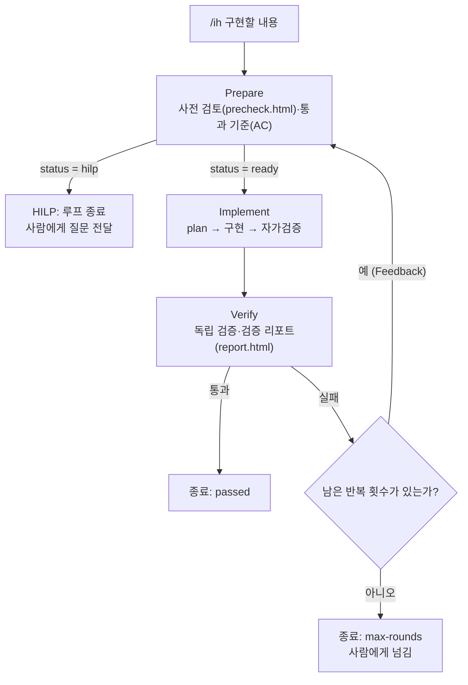

# Inner Loop 설계: `/ih` (Implement Harness, 구현 하네스)

`/ih <구현할 내용>` 한 줄로 **준비(Prepare) → 구현(Implement) → 검증(Verify)** 을 서브에이전트가 차례로 진행하고, 검증이 실패하면 **그 실패를 해결하기 위한 준비 단계로 되돌아가는** 루프입니다. 사람의 판단이 필요한 순간(HILP)에는 루프가 멈추고 사람에게 넘어갑니다.

> **상태**: 설계와 구현 파일을 완성했고, **첫 실제 실행(F-01 결함 수정 묶음)이 2라운드 만에 통과**했습니다. 실행 기록은 [10. 첫 실행 기록](#10-첫-실행-기록-f-01-결함-수정-묶음)에 있습니다. 아직 확인하지 못한 부분과 개선 과제는 [8. 확인하지 못한 것](#8-확인하지-못한-것)에 모았습니다.

## 1. 한눈에 보기



| 요소 | 규칙 |
|---|---|
| 호출 순서 | Prepare > Implement > Verify |
| **Feedback loop** | Verify 가 실패하면 **그 문제를 해결하기 위한 Prepare 단계로 돌아간다.** 이전 준비·구현·검증 결과를 함께 넘긴다 |
| **Human-in-the-loop** | **Prepare 가 HILP 를 요청하면 루프가 종료된다.** 그 외에는 사람 승인을 기다리며 멈추지 않는다 |
| 반복 한도 | 기본 **3회**(`maxRounds` 로 변경). 한도에 닿으면 `max-rounds` 로 종료하고 사람에게 넘긴다 |

## 2. 구성 요소

| 파일 | 역할 |
|---|---|
| `.claude/workflows/ih.js` | 동적 워크플로(Dynamic workflow). 루프 제어(순서·피드백·종료)를 코드로 고정한다. 명령 이름 `/ih` 는 파일 안 `meta.name` 에서 온다 |
| `.claude/agents/Prepare.md` | 준비 에이전트. 지침 문서: `docs/loops/templates/precheck.html` |
| `.claude/agents/Implement.md` | 구현 에이전트. plan·구현·자가검증까지 진행 |
| `.claude/agents/Verify.md` | 검증 에이전트. 지침 문서: `docs/loops/templates/report.html` |

- `.claude/commands/` 는 사용하지 않는다.
- **`.claude/` 는 하위 폴더까지 git 에서 제외되어 있다.** 위 4개 파일은 저장소에 올라가지 않는 로컬 파일이다. 이 문서는 Loop 코드 없이 **설계 설명만** 담으며, 구현의 입출력 약속은 [6장](#6-입출력-약속)에 정리했다.

## 3. 단계별 역할

| 단계 | 하는 일 | 증거 문서 | 하지 않는 일 |
|---|---|---|---|
| **Prepare** | 구현할 내용의 범위·근거·현재 상태·영향·환경을 **실제로 확인**하고 통과 기준(AC)을 정한다. 사람 판단이 필요하면 HILP | `precheck.html` (양식 1~9장) | 코드 수정, 브랜치 생성·변경, 개발 DB 변경(조회만) |
| **Implement** | **plan 을 세우고 → 구현하고 → 자가검증**한다 (빌드·단위 테스트, AC 대조, diff 점검) | 없음 (결과는 JSON 으로 반환) | 합격 단정, 커밋·push, 개발 DB 를 바꾸는 E2E 실행 |
| **Verify** | AC 를 **독립적으로** 하나씩 검증하고 리포트를 쓴다. 구현자의 자가검증은 믿지 않고 직접 확인 | `report.html` (양식 1~8장) | 코드 수정, AC 완화 |

증거 문서는 팀 증거 경로 규칙에 따라 `docs/evidence/오재석/TASK-{번호}-{작업명}/precheck.html`, `docs/evidence/오재석/TASK-{번호}-{작업명}/report.html` 에 저장한다(`{번호}` 는 `docs/evidence/오재석/` 아래 기존 `TASK-` 폴더의 다음 번호이고 없으면 `001`, `{작업명}` 은 Prepare 가 구현할 내용에서 뽑은 영문 kebab-case. 재시도에서는 같은 폴더의 같은 파일을 갱신). 두 문서 공통 원칙은 다음과 같다.

1. **실제로 확인한 것만** 적는다. 확인하지 못한 것은 "미확인"이나 `skip` 으로 적는다.
2. "확인했다"만 쓰지 않고 **근거**(명령과 결과, 파일 위치)를 남긴다.
3. **사람 확인(HITL) 칸**(precheck 9장, report 8장)은 AI 가 채우지 않는다.

## 4. 흐름과 종료 상태

1. **Prepare** 가 `precheck.html` 을 작성하고 `status` 를 `ready` 또는 `hilp` 로 답한다.
2. `hilp` 면 즉시 종료한다 (`status: 'hilp'`, 사유와 질문 반환).
3. `ready` 면 **Implement** 가 plan·구현·자가검증을 하고 결과를 돌려준다.
4. **Verify** 가 `report.html` 을 작성하고 AC 별 결과를 돌려준다.
5. 통과하면 종료한다. 실패하면 **이전 결과 전체를 Prepare 에 넘겨** 1번으로 돌아간다(Feedback).

| 종료 상태 | 언제 | 사람이 할 일 |
|---|---|---|
| `passed` | 모든 AC 통과 | `report.html` 8장에서 완료 인정 |
| `hilp` | Prepare 가 HILP 요청 | 질문에 답하거나 결정한 뒤 다시 `/ih` |
| `max-rounds` | 최대 반복 횟수까지 검증을 통과하지 못함 | 마지막 검증 결과를 보고 방향 결정 |
| `aborted` | 에이전트 응답이 없음(건너뜀·오류) | 원인 확인 후 재실행 |
| `error` | `/ih` 뒤에 구현할 내용이 없음 | 내용을 넣어 다시 실행 |

### 통과 판정 (워크플로가 한 번 더 확인)
Verify 의 `pass` 를 그대로 믿지 않는다. 다음 중 하나라도 있으면 **통과로 보지 않고 실패로 처리**한다.
- `blocker` 이슈가 있다
- 결과에 `pass` 가 아닌 AC(`fail`, `skip`)가 있다
- 이번 라운드에 구현이 `src/main/` 아래를 바꿨는데 **서버 재시작 증거**(`serverRestart.done = true`)가 없다. 영향이 작아 보여도 생략할 수 없다. 이 경우 워크플로가 `blocker` 이슈를 덧붙여 Prepare 로 되돌린다

## 5. HILP (사람 판단 요청) 조건

다음 중 하나라도 해당하면 Prepare 는 구현으로 넘기지 않고 `status = hilp` 로 답하고, 사유(`hilp.reason`)와 질문(`hilp.questions`)을 `precheck.html` 8장에도 남긴다.

- 구현 방향을 갈라 놓는 **열린 질문**이 있다 (요구가 모호함)
- **되돌릴 수 없는 작업**(데이터 삭제, push, 배포, 공유 DB 변경)이 필요하다
- `precheck.html` 7장의 **중단 조건**이 충족됐다 (같은 원인으로 2회 연속 실패, 범위 밖 수정 필요 등)
- 통과 기준을 바꿔야 한다 (실패를 피하려고 기준을 낮추지 않는다)
- 환경 점검이 막혔고 에이전트가 해결할 수 없다 (앱이 안 뜸, 기준선 테스트가 이미 실패 등)

**이 외에는 사람 승인을 기다리지 않고 구현까지 진행한다.** `precheck.html` 9장·`report.html` 8장의 사람 확인은 루프를 멈추지 않으며, 사람이 결과를 보고 사후에 판단한다.

## 6. 입출력 약속

에이전트는 JSON 스키마로 답하며(스키마가 틀리면 도구 호출 단계에서 재시도), 워크플로는 이 값으로 분기한다.

| 에이전트 | 입력 | 출력 (필수 *) |
|---|---|---|
| Prepare | 구현할 내용, 라운드, 최대 반복 횟수, (재시도) 이전 준비·구현·검증 결과 | `status`\*(`ready`/`hilp`), `precheckPath`\*, `brief`\*, `acceptanceCriteria`[`{id,given,when,then,verification}`], `hilp`{`reason`,`questions`} |
| Implement | 구현할 내용, Prepare 결과, (재시도) 이전 검증 실패 내용 | `summary`\*, `plan`\*, `changedFiles`\*, `selfCheck`\*{`passed`,`commands`,`notes`}, `openIssues` |
| Verify | 구현할 내용, Prepare 결과, Implement 결과, 이전 라운드 실패 기록 | `pass`\*, `summary`\*, `reportPath`\*, `finalResult`\*(`완료`/`부분 완료`/`미완료`), `serverRestart`\*{`required`,`done`,`method`,`evidence`}, `results`\*[`{ac,criterion,result,evidence}`], `issues`\*[`{severity,description,evidence}`] |

## 7. 설계 결정과 근거

| 결정 | 이유 |
|---|---|
| 루프 제어는 **워크플로 코드**가 하고, 판단은 에이전트가 한다 | 순서·피드백·종료를 모델 판단에 맡기면 건너뛰거나 끝없이 돌 수 있다. 제어를 코드로 고정하면 결정적이다 |
| **Verify 실패 → Prepare 복귀** (Implement 로 직행하지 않음) | 실패 원인이 구현이 아니라 통과 기준·환경·범위에 있을 수 있다. 원인을 먼저 파악한 뒤 준비를 다시 하는 것이 맞다 |
| **같은 `precheck.html` 을 갱신** (8장에 "라운드 N 보완") | 이전 점검 내용을 잃지 않고 보완 이력이 남는다 |
| 구현자(Implement)와 검증자(Verify)를 **분리** | 구현자가 자기 결과를 직접 합격시키면 맹점이 같다. 독립 확인이 필요하다 |
| Verify 의 `pass` 를 **워크플로가 재확인** | 모델이 "통과"라고 해도 실패·건너뜀 항목이 남아 있으면 통과가 아니다 |
| **통과 기준을 낮추지 않는다** | 재시도에서 기준을 완화하면 루프가 "통과하기 쉬운 쪽"으로 흐른다. 기준 변경은 사람의 결정(HILP)이다 |
| 사람 승인으로는 멈추지 않고 **HILP 조건에서만 멈춤** | 루프의 자동성을 유지하되, 사람이 꼭 필요한 순간만 넘긴다 (팀 결정) |
| 반복 한도 **기본 3회** | 무한 루프 방지용 안전장치. 값은 임의로 정한 기본값이며 `maxRounds` 로 바꿀 수 있다 |
| 증거 문서 위치 `docs/evidence/오재석/TASK-{번호}-{작업명}/` | 팀 증거 경로 규칙(`docs/evidence/{이름}/{작업번호+작업명}/`)을 따른다. 처음에는 양식 위치(`docs/loops/templates/`)와 나란한 `docs/loops/<기능-slug>/` 를 썼으나(F-01 실행 기록이 이 경로), 팀 규칙에 맞춰 바꿨다 |
| 에이전트를 **`agentType`** 으로 호출하고, 실패하면 역할 파일을 읽는 방식으로 **대체 호출** | 이 환경의 워크플로 규칙서에는 `agentType` 이 있으나 공식 문서 조사에서는 확인되지 않았다. 어느 쪽이든 동작하도록 안전장치를 두었다. 첫 실행에서 `agentType` 호출은 정상 동작했다 |
| `.claude/` 는 **git 제외 유지** | 팀 결정. 미션 지침에 따라 Loop 코드는 제출하지 않고 이 README 에 설계 설명만 둔다. 팀이 `.claude/` 를 공유할 방법은 별도로 정한다 |
| **서버 재시작은 에이전트가 IDEA MCP 로 직접** 한다 (Implement 자가검증, Verify 검증, Prepare 기준선 확인) | 코드를 바꾼 뒤 `localhost:8080` 이 옛 코드로 떠 있으면 E2E 검증이 무의미하다. 절차: `build_project`(devtools 자동 재시작) → `/login` 응답 대기(최대 90초) → 안 되면 `DemoApplication` 실행 구성 실행. 끝내 최신 코드가 아니면 `pass` 를 적지 않고 `skip` 으로 남긴다. **`src/main/` 아래가 바뀐 라운드에서는 판단으로 생략할 수 없다**(F-01 의 2라운드에서 Verify 가 "영향 없음"으로 생략한 사례 이후 강화). 워크플로가 재시작 필수 여부를 계산해 Verify 에 알려 주고, 재시작 증거가 없으면 통과로 인정하지 않는다 |

## 8. 확인하지 못한 것

| 항목 | 상태 |
|---|---|
| `/ih` 실제 실행 (end-to-end) | **확인됨** — F-01 로 실행해 2라운드 만에 `passed` ([10장](#10-첫-실행-기록-f-01-결함-수정-묶음)). 더 큰 기능, HILP 종료, `max-rounds` 종료는 아직 실행해 보지 않음 |
| `/ih 구현할 내용` 의 문자열이 스크립트 `args` 로 그대로 전달되는지 | **확인됨** — 여러 줄·특수문자가 든 긴 문자열이 그대로 전달되어, Prepare 가 내용을 정확히 이해하고 작업함 |
| `.claude/workflows/ih.js` 가 `/ih` 로 노출되는지 | **확인됨** — `/reload-skills` 뒤 스킬 목록에 `ih` 가 나타남 |
| `.claude/agents/*.md` 가 에이전트 유형으로 등록되는지 | **확인됨** — `Prepare`, `Implement`, `Verify` 가 에이전트 유형 목록에 나타남 |
| `agent(..., {agentType})` 가 실제로 그 에이전트를 가리키는지 | **동작 확인됨** — 세 에이전트가 각자의 지침대로 `precheck.html`·`report.html` 을 작성하며 동작함. 대체 호출(역할 파일 읽기)이 쓰였는지는 확인하지 않음 |
| IDEA MCP 로 빌드·재시작하는 절차(devtools 자동 재시작 포함) | **부분 확인** — 1라운드에서 구현자가 "8080 서버를 강제 종료한 뒤 IDEA 로 재시작했다"고 보고함(검증 리포트 기록). 정해 둔 절차(빌드 → 자동 재시작 → 실행 구성)대로였는지는 확인하지 못함 |
| **서버 재시작 규칙 준수** | **강화 반영, 아직 실행으로 검증하지 않음** — F-01 의 2라운드에서 Verify 가 "영향 없음"으로 판단해 재시작을 생략했다. 이후 (1) `Verify.md` 에 "판단으로 생략 금지"와 재시작 증거(바뀐 동작 직접 호출) 요구를 넣고, (2) 워크플로가 `src/main/` 변경 시 `serverRestart.done = true` 가 없으면 통과로 인정하지 않게 했다(로직은 단위 확인함). 다음 `/ih` 실행에서 실제로 동작하는지 확인이 필요함 |
| 검산 실패의 실제 재현 | **미확인** — 검산 실패는 목(mock)으로만 유발해 확인했고, 실제 입력으로 검산을 깨뜨리는 경우는 아직 모름 |
| "같은 원인 2회 연속 실패" 판정 | 현재는 Prepare 에이전트의 판단에 맡김. 워크플로가 강제하지 않음 |
| 개발 DB 를 바꾸는 검증(E2E) | `precheck.html` 4·5장에 영향과 정리 방법이 있을 때만 실행. 아니면 `skip` |

## 9. 사용 방법

```
/ih <구현할 내용>
```

- 인자는 문자열이거나 `{task, maxRounds}` 객체이다. 내용이 비어 있으면 `error` 로 끝난다.
- 반환값에는 `status`, 라운드 수, 마지막 결과(또는 HILP 질문), 라운드별 기록(`history`)이 들어 있다.
- 실행하면 에이전트가 실제로 **코드를 수정**한다. 커밋·push 는 하지 않으며, 변경 사항은 작업 폴더에 남는다.

## 10. 첫 실행 기록 (F-01 결함 수정 묶음)

`/ih` 로 진행한 첫 작업입니다. 4가지 결함을 고치는 묶음이며, 기존 E2E 테스트(`DTL-05`, `DTL-08`, `AUTH-03`)가 통과 기준 역할을 했습니다.

| 항목 | 값 |
|---|---|
| 구현할 내용 | ① 없는 주문 조회 HTTP 500 ② 취소 직후 이동 HTTP 500 ③ 계산 검산 실패가 일반 500 ④ 로그인 주소에 `;jsessionid` 노출 |
| 결과 | **`passed`, 2라운드** |
| 규모 | 에이전트 6개(라운드마다 Prepare·Implement·Verify), 약 17분, 서브에이전트 토큰 약 41.7만 |
| 증거 문서 | `precheck.html`, `report.html` (**로컬 생성물이며 이 저장소에는 없음**. F-01 은 경로 변경 전 실행이라 `docs/loops/f01-defect-fixes/` 에 있음) |
| 최종 검증 수치 | 단위·통합 테스트 26건 통과, E2E 72건 통과·1건 건너뜀(`LST-04`, 주문 0건일 때만 실행되어 허용) |

### 라운드별 흐름
| 라운드 | Prepare | Implement | Verify |
|---|---|---|---|
| 1 | 결함을 직접 재현해 원인 파악, `precheck.html` 작성, 통과 기준 5개(AC-1~5) 설정 | 결함 4건 수정과 테스트 추가 | 1·2·4번과 회귀는 통과. **3번(검산 실패)의 화면 쪽을 검증하지 못해 실패 처리** |
| 2 | 실패 원인을 "구현 결함이 아니라 **테스트 공백**"으로 진단, 같은 `precheck.html` 을 갱신하고 해결할 항목을 지정 | 검산 실패 화면 경로 정리와 테스트 추가 | 모든 AC 통과 → `passed` |

피드백 루프가 설계한 대로 동작한 사례입니다. Verify 가 "검증하지 못했다"를 숨기지 않고 실패로 돌려보냈고, Prepare 가 원인이 구현이 아니라 테스트에 있음을 구분해 보완 범위를 좁혔습니다.

### 바뀐 파일
- 소스: `AppController`, `Planner`, `application.properties`, `orders.html`(수정), `ErrorAdvice`, `PlanCalculationException`, `notice.html`(신규)
- 테스트: `OrderFlowTests`(수정), `CalculationErrorTests`(신규), E2E `order-detail.spec.ts`, `auth.spec.ts`(`test.fail` 표시와 `;jsessionid` 허용 정규식 제거)
- 요청하지 않은 미커밋 파일은 그대로였고, 커밋·push 는 하지 않았다.

### 사람이 별도로 확인한 것
- 실행 중인 서버에서 `/orders/999999` 가 **404** 이고 안내 문구가 표시된다.
- 로그인 화면 HTML 에 `jsessionid` 가 없다.
- 취소 직후 이동과 검산 실패 안내는 에이전트가 돌린 테스트 결과를 근거로 했다(직접 재현하지 않음).

### 관찰과 개선 과제
1. **서버 재시작 규칙을 판단으로 생략할 수 있었다 → 강화함.** 2라운드의 Verify 가 "영향이 없다"고 보고 재시작 없이 E2E 를 돌렸다. 이후 `src/main/` 이 바뀌면 영향 판단과 무관하게 재시작하도록 지침과 워크플로 통과 판정을 고쳤다(8장 참고). 다음 실행에서 동작 확인이 필요하다.
2. **구현자가 서버를 "강제 종료 후 IDEA 로 재시작"했다고 보고했다.** 정한 절차보다 거친 방식일 수 있어, 실제로 어떻게 했는지 확인과 절차 보완이 필요하다.
3. **검산 실패는 목으로만 확인했다.** 실제 입력으로 재현하는 경우는 모른다.
4. **E2E 가 개발 DB 에 데이터를 쌓는다.** 이 실행 뒤 주문이 63건, 마스터 변경 번호가 93 이었다. 고객 필수(F-05) 구현 시 기존 주문을 다시 삭제해야 한다.
5. **작은 결함 묶음에도 약 17분이 걸렸다.** 큰 기능에서는 라운드마다 E2E 전체를 돌리는 비용이 커진다. 회귀 범위를 영향 영역으로 좁힐지 검토할 만하다.
6. **아직 실행해 보지 않은 경로:** HILP 종료, `max-rounds` 종료, 에이전트 응답 없음(`aborted`).
