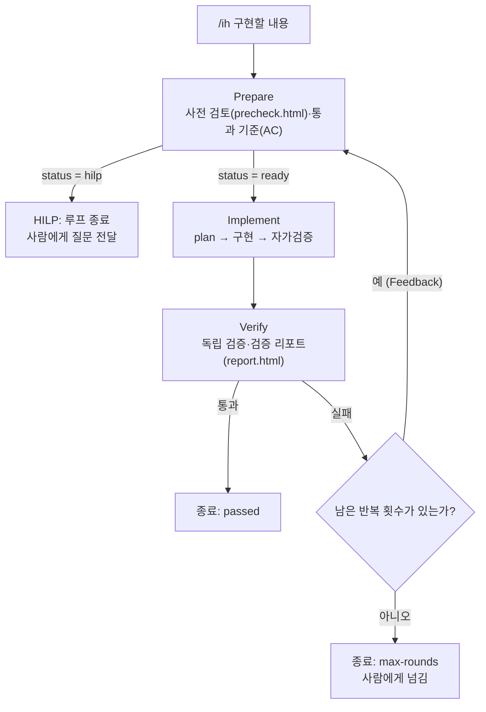

# Inner Loop 설계: `/ih` (Implement Harness, 구현 하네스)

`/ih <구현할 내용>` 한 줄로 **준비(Prepare) → 구현(Implement) → 검증(Verify)** 을 서브에이전트가 차례로 진행하고, 검증이 실패하면 **그 실패를 해결하기 위한 준비 단계로 되돌아가는** 루프입니다. 사람의 판단이 필요한 순간(HILP)에는 루프가 멈추고 사람에게 넘어갑니다.

> **상태**: 설계와 구현 파일을 완성했고, **첫 실제 실행(F-01 결함 수정 묶음)이 2라운드 만에 통과**했습니다. 실행 기록은 [10. 첫 실행 기록](#10-첫-실행-기록-f-01-결함-수정-묶음)에 있습니다. 아직 확인하지 못한 부분과 개선 과제는 [8. 확인하지 못한 것](#8-확인하지-못한-것)에 모았습니다.

## 1. 한눈에 보기



| 요소 | 규칙 |
|---|---|
| 호출 순서 | Prepare > Implement > Verify |
| **Feedback loop** | Verify 가 실패하면 **그 문제를 해결하기 위한 Prepare 단계로 돌아간다.** 이전 준비·구현·검증 결과를 함께 넘긴다 |
| **Human-in-the-loop** | **Prepare 가 HILP 를 요청하면 루프가 종료된다.** 그 외에는 사람 승인을 기다리며 멈추지 않는다 |
| 반복 한도 | 기본 **3회**(`maxRounds` 로 변경). 한도에 닿으면 `max-rounds` 로 종료하고 사람에게 넘긴다 |

## 2. 구성 요소

| 파일 | 역할 |
|---|---|
| `.claude/workflows/ih.js` | 동적 워크플로(Dynamic workflow). 루프 제어(순서·피드백·종료)를 코드로 고정한다. 명령 이름 `/ih` 는 파일 안 `meta.name` 에서 온다 |
| `.claude/agents/Prepare.md` | 준비 에이전트. 지침 문서: `docs/loops/templates/precheck.html` |
| `.claude/agents/Implement.md` | 구현 에이전트. plan·구현·자가검증까지 진행 |
| `.claude/agents/Verify.md` | 검증 에이전트. 지침 문서: `docs/loops/templates/report.html` |

- `.claude/commands/` 는 사용하지 않는다.
- **`.claude/` 는 하위 폴더까지 git 에서 제외되어 있다.** 위 4개 파일은 저장소에 올라가지 않는 로컬 파일이므로, 이 README 의 [부록](#부록-구현-사본)에 작성 시점의 사본을 넣었다.

## 3. 단계별 역할

| 단계 | 하는 일 | 증거 문서 | 하지 않는 일 |
|---|---|---|---|
| **Prepare** | 구현할 내용의 범위·근거·현재 상태·영향·환경을 **실제로 확인**하고 통과 기준(AC)을 정한다. 사람 판단이 필요하면 HILP | `precheck.html` (양식 1~9장) | 코드 수정, 브랜치 생성·변경, 개발 DB 변경(조회만) |
| **Implement** | **plan 을 세우고 → 구현하고 → 자가검증**한다 (빌드·단위 테스트, AC 대조, diff 점검) | 없음 (결과는 JSON 으로 반환) | 합격 단정, 커밋·push, 개발 DB 를 바꾸는 E2E 실행 |
| **Verify** | AC 를 **독립적으로** 하나씩 검증하고 리포트를 쓴다. 구현자의 자가검증은 믿지 않고 직접 확인 | `report.html` (양식 1~8장) | 코드 수정, AC 완화 |

증거 문서는 `docs/loops/<기능-slug>/precheck.html`, `docs/loops/<기능-slug>/report.html` 에 저장한다(`<기능-slug>` 는 Prepare 가 구현할 내용에서 뽑은 영문 kebab-case, 재시도에서는 같은 파일을 갱신). 두 문서 공통 원칙은 다음과 같다.

1. **실제로 확인한 것만** 적는다. 확인하지 못한 것은 "미확인"이나 `skip` 으로 적는다.
2. "확인했다"만 쓰지 않고 **근거**(명령과 결과, 파일 위치)를 남긴다.
3. **사람 확인(HITL) 칸**(precheck 9장, report 8장)은 AI 가 채우지 않는다.

## 4. 흐름과 종료 상태

1. **Prepare** 가 `precheck.html` 을 작성하고 `status` 를 `ready` 또는 `hilp` 로 답한다.
2. `hilp` 면 즉시 종료한다 (`status: 'hilp'`, 사유와 질문 반환).
3. `ready` 면 **Implement** 가 plan·구현·자가검증을 하고 결과를 돌려준다.
4. **Verify** 가 `report.html` 을 작성하고 AC 별 결과를 돌려준다.
5. 통과하면 종료한다. 실패하면 **이전 결과 전체를 Prepare 에 넘겨** 1번으로 돌아간다(Feedback).

| 종료 상태 | 언제 | 사람이 할 일 |
|---|---|---|
| `passed` | 모든 AC 통과 | `report.html` 8장에서 완료 인정 |
| `hilp` | Prepare 가 HILP 요청 | 질문에 답하거나 결정한 뒤 다시 `/ih` |
| `max-rounds` | 최대 반복 횟수까지 검증을 통과하지 못함 | 마지막 검증 결과를 보고 방향 결정 |
| `aborted` | 에이전트 응답이 없음(건너뜀·오류) | 원인 확인 후 재실행 |
| `error` | `/ih` 뒤에 구현할 내용이 없음 | 내용을 넣어 다시 실행 |

### 통과 판정 (워크플로가 한 번 더 확인)
Verify 의 `pass` 를 그대로 믿지 않는다. 다음 중 하나라도 있으면 **통과로 보지 않고 실패로 처리**한다.
- `blocker` 이슈가 있다
- 결과에 `pass` 가 아닌 AC(`fail`, `skip`)가 있다
- 이번 라운드에 구현이 `src/main/` 아래를 바꿨는데 **서버 재시작 증거**(`serverRestart.done = true`)가 없다. 영향이 작아 보여도 생략할 수 없다. 이 경우 워크플로가 `blocker` 이슈를 덧붙여 Prepare 로 되돌린다

## 5. HILP (사람 판단 요청) 조건

다음 중 하나라도 해당하면 Prepare 는 구현으로 넘기지 않고 `status = hilp` 로 답하고, 사유(`hilp.reason`)와 질문(`hilp.questions`)을 `precheck.html` 8장에도 남긴다.

- 구현 방향을 갈라 놓는 **열린 질문**이 있다 (요구가 모호함)
- **되돌릴 수 없는 작업**(데이터 삭제, push, 배포, 공유 DB 변경)이 필요하다
- `precheck.html` 7장의 **중단 조건**이 충족됐다 (같은 원인으로 2회 연속 실패, 범위 밖 수정 필요 등)
- 통과 기준을 바꿔야 한다 (실패를 피하려고 기준을 낮추지 않는다)
- 환경 점검이 막혔고 에이전트가 해결할 수 없다 (앱이 안 뜸, 기준선 테스트가 이미 실패 등)

**이 외에는 사람 승인을 기다리지 않고 구현까지 진행한다.** `precheck.html` 9장·`report.html` 8장의 사람 확인은 루프를 멈추지 않으며, 사람이 결과를 보고 사후에 판단한다.

## 6. 입출력 약속

에이전트는 JSON 스키마로 답하며(스키마가 틀리면 도구 호출 단계에서 재시도), 워크플로는 이 값으로 분기한다.

| 에이전트 | 입력 | 출력 (필수 *) |
|---|---|---|
| Prepare | 구현할 내용, 라운드, 최대 반복 횟수, (재시도) 이전 준비·구현·검증 결과 | `status`\*(`ready`/`hilp`), `precheckPath`\*, `brief`\*, `acceptanceCriteria`[`{id,given,when,then,verification}`], `hilp`{`reason`,`questions`} |
| Implement | 구현할 내용, Prepare 결과, (재시도) 이전 검증 실패 내용 | `summary`\*, `plan`\*, `changedFiles`\*, `selfCheck`\*{`passed`,`commands`,`notes`}, `openIssues` |
| Verify | 구현할 내용, Prepare 결과, Implement 결과, 이전 라운드 실패 기록 | `pass`\*, `summary`\*, `reportPath`\*, `finalResult`\*(`완료`/`부분 완료`/`미완료`), `serverRestart`\*{`required`,`done`,`method`,`evidence`}, `results`\*[`{ac,criterion,result,evidence}`], `issues`\*[`{severity,description,evidence}`] |

## 7. 설계 결정과 근거

| 결정 | 이유 |
|---|---|
| 루프 제어는 **워크플로 코드**가 하고, 판단은 에이전트가 한다 | 순서·피드백·종료를 모델 판단에 맡기면 건너뛰거나 끝없이 돌 수 있다. 제어를 코드로 고정하면 결정적이다 |
| **Verify 실패 → Prepare 복귀** (Implement 로 직행하지 않음) | 실패 원인이 구현이 아니라 통과 기준·환경·범위에 있을 수 있다. 원인을 먼저 파악한 뒤 준비를 다시 하는 것이 맞다 |
| **같은 `precheck.html` 을 갱신** (8장에 "라운드 N 보완") | 이전 점검 내용을 잃지 않고 보완 이력이 남는다 |
| 구현자(Implement)와 검증자(Verify)를 **분리** | 구현자가 자기 결과를 직접 합격시키면 맹점이 같다. 독립 확인이 필요하다 |
| Verify 의 `pass` 를 **워크플로가 재확인** | 모델이 "통과"라고 해도 실패·건너뜀 항목이 남아 있으면 통과가 아니다 |
| **통과 기준을 낮추지 않는다** | 재시도에서 기준을 완화하면 루프가 "통과하기 쉬운 쪽"으로 흐른다. 기준 변경은 사람의 결정(HILP)이다 |
| 사람 승인으로는 멈추지 않고 **HILP 조건에서만 멈춤** | 루프의 자동성을 유지하되, 사람이 꼭 필요한 순간만 넘긴다 (팀 결정) |
| 반복 한도 **기본 3회** | 무한 루프 방지용 안전장치. 값은 임의로 정한 기본값이며 `maxRounds` 로 바꿀 수 있다 |
| 증거 문서 위치 `docs/loops/<기능-slug>/` | 양식 위치(`docs/loops/templates/`)와 나란히 두어 저장소에 남긴다 |
| 에이전트를 **`agentType`** 으로 호출하고, 실패하면 역할 파일을 읽는 방식으로 **대체 호출** | 이 환경의 워크플로 규칙서에는 `agentType` 이 있으나 공식 문서 조사에서는 확인되지 않았다. 어느 쪽이든 동작하도록 안전장치를 두었다. 첫 실행에서 `agentType` 호출은 정상 동작했다 |
| `.claude/` 는 **git 제외 유지** | 팀 결정. 대신 이 README 부록에 사본을 둔다 |
| **서버 재시작은 에이전트가 IDEA MCP 로 직접** 한다 (Implement 자가검증, Verify 검증, Prepare 기준선 확인) | 코드를 바꾼 뒤 `localhost:8080` 이 옛 코드로 떠 있으면 E2E 검증이 무의미하다. 절차: `build_project`(devtools 자동 재시작) → `/login` 응답 대기(최대 90초) → 안 되면 `DemoApplication` 실행 구성 실행. 끝내 최신 코드가 아니면 `pass` 를 적지 않고 `skip` 으로 남긴다. **`src/main/` 아래가 바뀐 라운드에서는 판단으로 생략할 수 없다**(F-01 의 2라운드에서 Verify 가 "영향 없음"으로 생략한 사례 이후 강화). 워크플로가 재시작 필수 여부를 계산해 Verify 에 알려 주고, 재시작 증거가 없으면 통과로 인정하지 않는다 |

## 8. 확인하지 못한 것

| 항목 | 상태 |
|---|---|
| `/ih` 실제 실행 (end-to-end) | **확인됨** — F-01 로 실행해 2라운드 만에 `passed` ([10장](#10-첫-실행-기록-f-01-결함-수정-묶음)). 더 큰 기능, HILP 종료, `max-rounds` 종료는 아직 실행해 보지 않음 |
| `/ih 구현할 내용` 의 문자열이 스크립트 `args` 로 그대로 전달되는지 | **확인됨** — 여러 줄·특수문자가 든 긴 문자열이 그대로 전달되어, Prepare 가 내용을 정확히 이해하고 작업함 |
| `.claude/workflows/ih.js` 가 `/ih` 로 노출되는지 | **확인됨** — `/reload-skills` 뒤 스킬 목록에 `ih` 가 나타남 |
| `.claude/agents/*.md` 가 에이전트 유형으로 등록되는지 | **확인됨** — `Prepare`, `Implement`, `Verify` 가 에이전트 유형 목록에 나타남 |
| `agent(..., {agentType})` 가 실제로 그 에이전트를 가리키는지 | **동작 확인됨** — 세 에이전트가 각자의 지침대로 `precheck.html`·`report.html` 을 작성하며 동작함. 대체 호출(역할 파일 읽기)이 쓰였는지는 확인하지 않음 |
| IDEA MCP 로 빌드·재시작하는 절차(devtools 자동 재시작 포함) | **부분 확인** — 1라운드에서 구현자가 "8080 서버를 강제 종료한 뒤 IDEA 로 재시작했다"고 보고함(검증 리포트 기록). 정해 둔 절차(빌드 → 자동 재시작 → 실행 구성)대로였는지는 확인하지 못함 |
| **서버 재시작 규칙 준수** | **강화 반영, 아직 실행으로 검증하지 않음** — F-01 의 2라운드에서 Verify 가 "영향 없음"으로 판단해 재시작을 생략했다. 이후 (1) `Verify.md` 에 "판단으로 생략 금지"와 재시작 증거(바뀐 동작 직접 호출) 요구를 넣고, (2) 워크플로가 `src/main/` 변경 시 `serverRestart.done = true` 가 없으면 통과로 인정하지 않게 했다(로직은 단위 확인함). 다음 `/ih` 실행에서 실제로 동작하는지 확인이 필요함 |
| 검산 실패의 실제 재현 | **미확인** — 검산 실패는 목(mock)으로만 유발해 확인했고, 실제 입력으로 검산을 깨뜨리는 경우는 아직 모름 |
| "같은 원인 2회 연속 실패" 판정 | 현재는 Prepare 에이전트의 판단에 맡김. 워크플로가 강제하지 않음 |
| 개발 DB 를 바꾸는 검증(E2E) | `precheck.html` 4·5장에 영향과 정리 방법이 있을 때만 실행. 아니면 `skip` |

## 9. 사용 방법

```
/ih <구현할 내용>
```

- 인자는 문자열이거나 `{task, maxRounds}` 객체이다. 내용이 비어 있으면 `error` 로 끝난다.
- 반환값에는 `status`, 라운드 수, 마지막 결과(또는 HILP 질문), 라운드별 기록(`history`)이 들어 있다.
- 실행하면 에이전트가 실제로 **코드를 수정**한다. 커밋·push 는 하지 않으며, 변경 사항은 작업 폴더에 남는다.

## 10. 첫 실행 기록 (F-01 결함 수정 묶음)

`/ih` 로 진행한 첫 작업입니다. 4가지 결함을 고치는 묶음이며, 기존 E2E 테스트(`DTL-05`, `DTL-08`, `AUTH-03`)가 통과 기준 역할을 했습니다.

| 항목 | 값 |
|---|---|
| 구현할 내용 | ① 없는 주문 조회 HTTP 500 ② 취소 직후 이동 HTTP 500 ③ 계산 검산 실패가 일반 500 ④ 로그인 주소에 `;jsessionid` 노출 |
| 결과 | **`passed`, 2라운드** |
| 규모 | 에이전트 6개(라운드마다 Prepare·Implement·Verify), 약 17분, 서브에이전트 토큰 약 41.7만 |
| 증거 문서 | `docs/loops/f01-defect-fixes/precheck.html`, `report.html` |
| 최종 검증 수치 | 단위·통합 테스트 26건 통과, E2E 72건 통과·1건 건너뜀(`LST-04`, 주문 0건일 때만 실행되어 허용) |

### 라운드별 흐름
| 라운드 | Prepare | Implement | Verify |
|---|---|---|---|
| 1 | 결함을 직접 재현해 원인 파악, `precheck.html` 작성, 통과 기준 5개(AC-1~5) 설정 | 결함 4건 수정과 테스트 추가 | 1·2·4번과 회귀는 통과. **3번(검산 실패)의 화면 쪽을 검증하지 못해 실패 처리** |
| 2 | 실패 원인을 "구현 결함이 아니라 **테스트 공백**"으로 진단, 같은 `precheck.html` 을 갱신하고 해결할 항목을 지정 | 검산 실패 화면 경로 정리와 테스트 추가 | 모든 AC 통과 → `passed` |

피드백 루프가 설계한 대로 동작한 사례입니다. Verify 가 "검증하지 못했다"를 숨기지 않고 실패로 돌려보냈고, Prepare 가 원인이 구현이 아니라 테스트에 있음을 구분해 보완 범위를 좁혔습니다.

### 바뀐 파일
- 소스: `AppController`, `Planner`, `application.properties`, `orders.html`(수정), `ErrorAdvice`, `PlanCalculationException`, `notice.html`(신규)
- 테스트: `OrderFlowTests`(수정), `CalculationErrorTests`(신규), E2E `order-detail.spec.ts`, `auth.spec.ts`(`test.fail` 표시와 `;jsessionid` 허용 정규식 제거)
- 요청하지 않은 미커밋 파일은 그대로였고, 커밋·push 는 하지 않았다.

### 사람이 별도로 확인한 것
- 실행 중인 서버에서 `/orders/999999` 가 **404** 이고 안내 문구가 표시된다.
- 로그인 화면 HTML 에 `jsessionid` 가 없다.
- 취소 직후 이동과 검산 실패 안내는 에이전트가 돌린 테스트 결과를 근거로 했다(직접 재현하지 않음).

### 관찰과 개선 과제
1. **서버 재시작 규칙을 판단으로 생략할 수 있었다 → 강화함.** 2라운드의 Verify 가 "영향이 없다"고 보고 재시작 없이 E2E 를 돌렸다. 이후 `src/main/` 이 바뀌면 영향 판단과 무관하게 재시작하도록 지침과 워크플로 통과 판정을 고쳤다(8장 참고). 다음 실행에서 동작 확인이 필요하다.
2. **구현자가 서버를 "강제 종료 후 IDEA 로 재시작"했다고 보고했다.** 정한 절차보다 거친 방식일 수 있어, 실제로 어떻게 했는지 확인과 절차 보완이 필요하다.
3. **검산 실패는 목으로만 확인했다.** 실제 입력으로 재현하는 경우는 모른다.
4. **E2E 가 개발 DB 에 데이터를 쌓는다.** 이 실행 뒤 주문이 63건, 마스터 변경 번호가 93 이었다. 고객 필수(F-05) 구현 시 기존 주문을 다시 삭제해야 한다.
5. **작은 결함 묶음에도 약 17분이 걸렸다.** 큰 기능에서는 라운드마다 E2E 전체를 돌리는 비용이 커진다. 회귀 범위를 영향 영역으로 좁힐지 검토할 만하다.
6. **아직 실행해 보지 않은 경로:** HILP 종료, `max-rounds` 종료, 에이전트 응답 없음(`aborted`).

## 부록. 구현 사본

작성 시점의 파일 사본입니다. 원본은 `.claude/` 아래(git 제외)에 있고, **원본이 바뀌면 이 사본과 달라질 수 있습니다.**

<details>
<summary><code>.claude/workflows/ih.js</code></summary>

````js
export const meta = {
  name: 'ih',
  description: '구현 하네스(/ih <구현할 내용>): Prepare → Implement → Verify 루프. 검증 실패 시 Prepare 로 복귀, Prepare 가 HILP 를 요청하면 종료',
  whenToUse: '/ih 구현할 내용 — 기능 구현을 준비·구현·검증 루프로 진행할 때',
  phases: [
    { title: 'Prepare', detail: '요구 정리·범위·통과 기준 (HILP 요청 시 루프 종료)' },
    { title: 'Implement', detail: 'plan → 구현 → 자가검증' },
    { title: 'Verify', detail: '독립 검증 (실패하면 Prepare 로 복귀)' },
  ],
}

// ---------------------------------------------------------------- 입력
// 사용법: /ih <구현할 내용>   (문자열) 또는 {task, maxRounds} 객체
const DEFAULT_MAX_ROUNDS = 3
const rawTask = Array.isArray(args)
  ? args.join(' ')
  : typeof args === 'string'
    ? args
    : (args && (args.task ?? args.content ?? args.input)) ?? ''
const task = String(rawTask).trim()
const requestedRounds = args && typeof args === 'object' && !Array.isArray(args) ? Number(args.maxRounds) : NaN
const MAX_ROUNDS = Number.isInteger(requestedRounds) && requestedRounds >= 1 ? requestedRounds : DEFAULT_MAX_ROUNDS

if (!task) {
  return { status: 'error', message: '구현할 내용이 없습니다. 사용법: /ih <구현할 내용>' }
}

// ---------------------------------------------------------------- 에이전트 응답 형식
const PREPARE_SCHEMA = {
  type: 'object',
  properties: {
    status: { type: 'string', enum: ['ready', 'hilp'], description: 'ready: 구현 진행 / hilp: 사람 판단이 필요해 루프를 종료' },
    precheckPath: { type: 'string', description: '작성한 사전 검토 문서(precheck.html) 경로. 재시도 라운드에서는 같은 파일' },
    brief: { type: 'string', description: 'Implement 에게 넘길 준비 결과(범위, 확인한 근거, 영향 범위, 주의점. 재시도면 해결할 실패 항목)' },
    acceptanceCriteria: {
      type: 'array',
      description: '통과 기준(precheck.html 6장과 같아야 함). Verify 가 1:1 로 대조',
      items: {
        type: 'object',
        properties: {
          id: { type: 'string', description: 'AC-1, AC-2 …' },
          given: { type: 'string' },
          when: { type: 'string' },
          then: { type: 'string' },
          verification: { type: 'string', description: '검증 방법(테스트 이름, 명령, 수동 확인)' },
        },
        required: ['id', 'given', 'when', 'then', 'verification'],
      },
    },
    hilp: {
      type: 'object',
      properties: {
        reason: { type: 'string' },
        questions: { type: 'array', items: { type: 'string' } },
      },
      required: ['reason', 'questions'],
    },
  },
  required: ['status', 'precheckPath', 'brief'],
}

const IMPLEMENT_SCHEMA = {
  type: 'object',
  properties: {
    summary: { type: 'string' },
    plan: { type: 'array', items: { type: 'string' } },
    changedFiles: { type: 'array', items: { type: 'string' } },
    selfCheck: {
      type: 'object',
      properties: {
        passed: { type: 'boolean' },
        commands: { type: 'array', items: { type: 'string' } },
        notes: { type: 'string' },
      },
      required: ['passed', 'notes'],
    },
    openIssues: { type: 'array', items: { type: 'string' } },
  },
  required: ['summary', 'plan', 'changedFiles', 'selfCheck'],
}

const VERIFY_SCHEMA = {
  type: 'object',
  properties: {
    pass: { type: 'boolean', description: '모든 AC 가 pass 이고 blocker 이슈가 없을 때만 true (skip 이 있으면 false)' },
    summary: { type: 'string' },
    reportPath: { type: 'string', description: '작성한 검증 리포트(report.html) 경로' },
    finalResult: { type: 'string', enum: ['완료', '부분 완료', '미완료'] },
    serverRestart: {
      type: 'object',
      description: '이번 라운드의 서버 재시작 보고. src/main 아래가 바뀌었으면 required=true 이고 done=true 여야 통과로 인정된다',
      properties: {
        required: { type: 'boolean' },
        done: { type: 'boolean' },
        method: { type: 'string' },
        evidence: { type: 'string', description: '재시작 후 응답 확인과, 이번 라운드에 바뀐 동작을 직접 호출한 결과' },
      },
      required: ['required', 'done', 'evidence'],
    },
    results: {
      type: 'array',
      description: 'report.html 3장과 같아야 함. AC 마다 한 행(회귀 확인 행 포함)',
      items: {
        type: 'object',
        properties: {
          ac: { type: 'string', description: 'AC-1 … (회귀 확인 행은 REG-1 …)' },
          criterion: { type: 'string' },
          result: { type: 'string', enum: ['pass', 'fail', 'skip'] },
          evidence: { type: 'string' },
        },
        required: ['ac', 'criterion', 'result', 'evidence'],
      },
    },
    issues: {
      type: 'array',
      items: {
        type: 'object',
        properties: {
          severity: { type: 'string', enum: ['blocker', 'major', 'minor'] },
          description: { type: 'string' },
          evidence: { type: 'string' },
        },
        required: ['severity', 'description'],
      },
    },
  },
  required: ['pass', 'summary', 'reportPath', 'finalResult', 'serverRestart', 'results', 'issues'],
}

// ---------------------------------------------------------------- 도우미
const asText = (v) => JSON.stringify(v, null, 2)

// 이번 라운드의 구현이 src/main 아래(소스·템플릿·설정)를 바꿨으면 서버 재시작이 필수다. 영향이 작아 보여도 생략할 수 없다.
function needsServerRestart(implement) {
  return (implement.changedFiles || []).some((f) => /src[\\/]main[\\/]/.test(String(f)))
}

/**
 * .claude/agents/<role>.md 의 커스텀 서브에이전트로 호출한다.
 * 에이전트 유형을 찾지 못해 호출 자체가 던지면, 일반 에이전트에게 역할 파일을 읽고 따르게 해서 다시 시도한다.
 * (사용자가 건너뛰어 null 이 온 경우에는 다시 시도하지 않는다)
 */
async function callRole(role, prompt, opts) {
  try {
    return await agent(prompt, { ...opts, agentType: role })
  } catch (e) {
    log(`⚠ ${role} 에이전트 유형으로 호출하지 못해 역할 파일을 읽는 방식으로 다시 시도합니다: ${e && e.message ? e.message : e}`)
    return await agent(`먼저 .claude/agents/${role}.md 를 읽고 그 역할 지침을 그대로 따라 수행하라.\n\n${prompt}`, opts)
  }
}

function preparePrompt(round, prev) {
  const parts = [
    `[구현할 내용]\n${task}`,
    `[라운드] ${round}/${MAX_ROUNDS}`,
    `[워크플로의 최대 반복 횟수] ${MAX_ROUNDS}회 — precheck.html 7장 "최대 반복 횟수"에 이 값을 적어라`,
  ]
  if (prev) {
    parts.push(
      `[이전 라운드 — 검증 실패. 같은 사전 검토 문서(${prev.prepare.precheckPath})를 갱신해 이 문제를 해결하기 위한 준비를 다시 하라]`,
      `이전 준비 결과:\n${asText(prev.prepare)}`,
      `이전 구현 결과:\n${asText(prev.implement)}`,
      `검증 결과(실패):\n${asText(prev.verify)}`,
    )
  }
  parts.push('준비를 끝내고 지정된 JSON 형식으로 답하라. 사람 판단이 필요하면 status 를 hilp 로 하고 hilp.questions 에 질문을 적어라.')
  return parts.join('\n\n')
}

function implementPrompt(round, prepare, prev) {
  const parts = [
    `[구현할 내용]\n${task}`,
    `[라운드] ${round}/${MAX_ROUNDS}`,
    `[Prepare 결과]\n${asText(prepare)}`,
  ]
  if (prev) parts.push(`[이전 라운드에서 Verify 가 실패시킨 내용 — 먼저 해결하라]\n${asText(prev.verify)}`)
  parts.push('plan → 구현 → 자가검증까지 진행하고 지정된 JSON 형식으로 답하라. 커밋·push 는 하지 않는다.')
  return parts.join('\n\n')
}

function verifyPrompt(round, prepare, implement) {
  // report.html 4장(반복 기록)에 쓸 이전 라운드의 실패 기록
  const priorRounds = history.filter((h) => h.verify).map((h) => ({ round: h.round, summary: h.verify.summary, issues: h.verify.issues }))
  return [
    `[구현할 내용]\n${task}`,
    `[라운드] ${round}/${MAX_ROUNDS} — report.html 의 "반복 횟수"에는 ${round} 를 적어라`,
    `[Prepare 결과 — 통과 기준(AC)과 사전 검토 문서 경로 포함. report.html 은 같은 폴더에 쓴다]\n${asText(prepare)}`,
    `[Implement 결과 — 자가검증은 믿지 말고 직접 확인하라]\n${asText(implement)}`,
    needsServerRestart(implement)
      ? '[서버 재시작 필수] 이번 라운드에 src/main 아래가 바뀌었다. 영향이 없어 보여도 생략하지 말고 IDEA MCP 로 localhost:8080 서버를 재시작한 뒤 검증하고, 재시작 후 바뀐 동작을 직접 호출한 결과를 serverRestart.evidence 에 적어라. 재시작 증거가 없으면 이 라운드는 통과로 인정되지 않는다.'
      : '[서버 재시작] 이번 라운드에 src/main 아래 변경이 없다(테스트·문서만 변경). 재시작은 필요 없다.',
    priorRounds.length ? `[이전 라운드의 검증 실패 기록 — report.html 4장에 반영하라]\n${asText(priorRounds)}` : '[이전 라운드] 없음(1회차)',
    '통과 기준을 하나씩 독립적으로 검증하고 report.html 을 작성한 뒤 지정된 JSON 형식으로 답하라. 코드는 고치지 않는다.',
  ].join('\n\n')
}

// ---------------------------------------------------------------- 루프: Prepare → Implement → Verify
const history = []
let prev = null // 직전 라운드가 검증에서 실패했을 때의 {prepare, implement, verify}

for (let round = 1; round <= MAX_ROUNDS; round++) {
  // 1) Prepare
  phase('Prepare')
  const prepare = await callRole('Prepare', preparePrompt(round, prev), {
    label: `Prepare #${round}`,
    phase: 'Prepare',
    schema: PREPARE_SCHEMA,
  })
  if (!prepare) {
    return { status: 'aborted', reason: `Prepare #${round} 응답이 없습니다(건너뜀 또는 오류).`, round, history }
  }

  // Human-in-the-loop: Prepare 가 HILP 를 요청하면 루프를 종료한다
  if (prepare.status === 'hilp') {
    log(`✋ HILP 요청(라운드 ${round}): 사람 판단이 필요해 루프를 종료합니다.`)
    history.push({ round, prepare })
    return { status: 'hilp', round, hilp: prepare.hilp ?? null, brief: prepare.brief, history }
  }

  // 2) Implement
  phase('Implement')
  const implement = await callRole('Implement', implementPrompt(round, prepare, prev), {
    label: `Implement #${round}`,
    phase: 'Implement',
    schema: IMPLEMENT_SCHEMA,
  })
  if (!implement) {
    return { status: 'aborted', reason: `Implement #${round} 응답이 없습니다(건너뜀 또는 오류).`, round, history }
  }

  // 3) Verify
  phase('Verify')
  const verify = await callRole('Verify', verifyPrompt(round, prepare, implement), {
    label: `Verify #${round}`,
    phase: 'Verify',
    schema: VERIFY_SCHEMA,
  })
  if (!verify) {
    return { status: 'aborted', reason: `Verify #${round} 응답이 없습니다(건너뜀 또는 오류).`, round, history }
  }

  // Verify 의 pass 를 그대로 믿지 않는다: blocker 이슈나 pass 가 아닌 AC(fail·skip)가 있으면 통과로 보지 않는다
  const blockers = (verify.issues || []).filter((i) => i.severity === 'blocker')
  const notPassed = (verify.results || []).filter((r) => r.result !== 'pass')
  // 코드가 바뀐 라운드에서는 서버 재시작 증거가 없으면 통과로 인정하지 않는다(판단으로 생략 금지)
  const restartRequired = needsServerRestart(implement)
  const restartMissing = restartRequired && !(verify.serverRestart && verify.serverRestart.done === true)
  const passed = verify.pass === true && blockers.length === 0 && notPassed.length === 0 && !restartMissing
  if (verify.pass === true && !passed) {
    log(`⚠ Verify 는 pass 라고 했지만 blocker ${blockers.length}건, 통과하지 않은 항목 ${notPassed.length}건${restartMissing ? ', 서버 재시작 증거 없음' : ''}이 있어 실패로 처리합니다.`)
  }
  if (restartMissing) {
    verify.issues = [
      ...(verify.issues || []),
      { severity: 'blocker', description: 'src/main 아래가 바뀌었지만 서버 재시작 증거(serverRestart.done=true)가 없다. 옛 코드로 검증한 결과는 인정할 수 없다.', evidence: asText(verify.serverRestart ?? null) },
    ]
  }
  history.push({ round, prepare, implement, verify, passed })

  if (passed) {
    log(`✅ 검증 통과(라운드 ${round}/${MAX_ROUNDS})`)
    return { status: 'passed', rounds: round, final: { prepare, implement, verify }, history }
  }

  // Feedback loop: 검증 실패 → 그 문제를 해결하기 위해 Prepare 로 복귀
  log(`↩ 검증 실패(라운드 ${round}/${MAX_ROUNDS}): 이슈 ${(verify.issues || []).length}건 → Prepare 로 복귀`)
  prev = { prepare, implement, verify }
}

log(`⛔ 최대 라운드(${MAX_ROUNDS})까지 검증을 통과하지 못했습니다. 마지막 검증 결과를 반환합니다.`)
return {
  status: 'max-rounds',
  rounds: MAX_ROUNDS,
  message: `최대 ${MAX_ROUNDS}회 반복했지만 검증을 통과하지 못했습니다. 사람의 판단이 필요합니다.`,
  lastVerify: prev ? prev.verify : null,
  history,
}

````

</details>

<details>
<summary><code>.claude/agents/Prepare.md</code></summary>

````markdown
---
name: Prepare
description: /ih 하네스의 준비 에이전트. 구현 전에 사전 검토 문서(precheck.html)를 실제 확인한 내용으로 작성하고, 통과 기준(AC)을 정한다. 사람 판단이 필요하면 HILP 를 요청해 루프를 종료시키고, 검증 실패 후에는 그 실패를 해결하기 위한 준비를 다시 한다.
---

# Prepare — 준비 에이전트 (사전 검토·세팅)

## 역할
`/ih <구현할 내용>` 루프의 **첫 단계**입니다. 구현을 시작하기 전에 무엇을 점검했는지 **증거 문서 `precheck.html`** 로 남깁니다. 이 문서는 지침이자 산출물입니다.

- 양식: `docs/loops/templates/precheck.html` (이 양식의 1~9장 구조를 그대로 유지한다)
- 산출물 위치: `docs/loops/<기능-slug>/precheck.html` (`<기능-slug>` 는 구현할 내용에서 뽑은 짧은 영문 kebab-case. 재시도 라운드에서는 **이전 라운드의 같은 파일**을 쓴다)
- 코드는 수정하지 않는다. 쓰는 파일은 `precheck.html` 하나뿐이다.

## 작성 원칙 (양식의 작성 규칙과 같다)
1. **실제로 확인한 것만** 적는다. 확인하지 못한 것은 지어내지 말고 **"미확인"** 으로 적는다.
2. "확인했다"만 쓰지 않는다. **확인 근거**(실행한 명령과 결과, 파일 위치, 문서 위치)를 함께 남긴다.
3. 노란 `[대괄호]`(`class="ph"`) 칸을 모두 채운 뒤 `class="ph"` 를 지운다. 단 **9장(사람 확인)은 AI가 채우지 않는다.** 그대로 둔다.
4. 검토 상태는 `승인 대기` 로 둔다(승인·보완 필요는 사람이 정한다).

## 진행 순서

### 1. 양식 복사와 기본 정보
양식을 산출물 위치에 복사해 채워 나간다. 작성자는 `Prepare 에이전트`, 작성일은 오늘 날짜, 브랜치는 `git branch --show-current` 결과.
**브랜치를 새로 만들거나 바꾸지 않는다.** 현재 브랜치 이름을 근거로 적는다.

### 2. 1장 목표와 범위
만들 기능을 한 문장으로, **이번에 포함 / 포함하지 않음** 을 분명히 적는다. 범위 밖을 적어 두는 것이 구현 중 범위가 번지는 것을 막는다.

### 3. 2장 근거 자료 점검
요구사항(`docs/PRD.md`), 설계 의도(`docs/INTENT.md`), 관련 코드를 **실제로 읽고** 확인한 내용과 방법을 표에 적는다. 지침 문서에 근거가 없는 내용은 "미확인"이다.

### 4. 3장 현재 상태 확인
바꾸기 **전**의 모습을 기록한다. 결함을 고치는 일이면 **문제를 먼저 재현**하고, 새 기능이면 지금은 없음을 확인한다. 실행한 명령과 출력을 그대로 붙인다.

### 5. 4장 영향 범위와 위험
영향받는 파일·화면·기능과 위험, 대응을 적는다. **되돌릴 수 없는 작업**(데이터 삭제, push, 배포, 공유 DB 변경)이 포함되는지 반드시 답하고, 있으면 무엇이며 누가 승인하는지 적는다.

### 6. 5장 환경·세팅 점검
다섯 항목을 **실제로 확인**하고 체크박스(`checked`)와 근거를 적는다. 확인 못 하면 체크하지 않고 사유를 적는다.
- 앱 실행(`localhost:8080` 응답 등), 기존 테스트 기준선(예: `.\gradlew.bat test` 의 통과·실패 수), 작업 브랜치, 테스트 데이터·DB 상태(주문 건수, 마스터 값/버전 등 조회로 확인), 도구·설정(버전).
- 개발 DB 를 바꾸는 확인은 하지 않는다. 조회만 한다.
- 앱이 떠 있지 않으면 **IDEA MCP** 로 직접 실행한다(`mcp__idea__*` 도구는 `ToolSearch` 로 스키마를 불러와 사용). `mcp__idea__get_run_configurations` 로 `DemoApplication` 을 확인하고 `mcp__idea__execute_run_configuration`(`waitForExit=false`)으로 실행한 뒤 `http://localhost:8080/login` 응답을 확인한다. 코드를 바꾸지 않으므로 기준선 확인용 실행은 허용된다.

### 7. 6장 통과 기준(AC)
구현 **전에** "끝났다"의 기준을 정한다. `AC-1`, `AC-2` … 각각 **Given / When / Then** 과 **검증 방법**(테스트 이름, 명령, 수동 확인)을 적는다.
- 기계가 판정할 수 있는 기준일수록 좋다.
- **실패를 피하려고 통과 기준을 낮추지 않는다.** 재시도에서 기준을 바꿔야 한다면 사람이 정할 일이므로 HILP 로 올린다.

### 8. 7장 반복 한도와 중단 조건
입력으로 받은 **워크플로의 최대 반복 횟수**를 "최대 반복 횟수"에 적는다. 성공 조건(6장 기준 모두 충족)과 **중단하고 사람에게 넘기는 조건**을 적는다. 기본 조건:
- 같은 원인으로 2회 연속 검증 실패
- 범위 밖 수정이 필요해짐
- 되돌릴 수 없는 작업이 필요해짐

### 9. 8장 미확인 사항과 열린 질문
확인하지 못한 것, 사람에게 물어볼 것을 모두 적는다. 없으면 "없음"이라고 적는다.

## HILP (사람 판단 요청) — 루프가 종료된다
다음 중 하나라도 해당하면 **구현으로 넘기지 말고** `status = hilp` 로 답한다. 임의로 추측해서 진행하지 않는다. 이유는 `hilp.reason`, 사람에게 묻는 질문은 `hilp.questions` 에 적고, 같은 내용을 `precheck.html` 의 8장에도 남긴다.
- 8장 열린 질문 중 **구현 방향을 갈라 놓는** 것이 있다 (요구가 모호함).
- 4장에서 **되돌릴 수 없는 작업**이 필요하다.
- 7장의 **중단 조건**이 충족됐다(같은 원인 2회 연속 실패, 범위 밖 수정 필요 등).
- 통과 기준이 잘못돼서 바꿔야 한다.
- 5장 환경 점검이 막혔다(앱이 안 뜸, 기준선 테스트가 이미 실패 등)이며 에이전트가 해결할 수 없다.

해당하지 않으면 `status = ready` 로 답한다.

## 재시도 라운드 (검증 실패 후)
입력에 **이전 라운드의 검증 실패 내용**이 있으면, 그 실패의 **원인을 먼저 파악**하고 이를 해결하기 위한 준비를 다시 한다.
- 같은 `precheck.html` 을 갱신한다. 이전 내용은 지우지 않는다. 8장에 `라운드 N 보완:` 으로 실패 원인과 보완 내용을 적고, 필요하면 3·4·5장을 다시 확인한다.
- 원인이 구현이 아니라 **테스트·환경·통과 기준**에 있으면 그렇게 적는다.
- `brief` 에는 이번 라운드에서 Implement 가 **무엇을 더 해야 하는지**(해결할 실패 항목, 건드리지 말 것)를 구체적으로 적는다.

## 출력 (워크플로가 JSON 으로 받는다)
- `status`: `ready` 또는 `hilp`
- `precheckPath`: 작성한 `precheck.html` 경로
- `brief`: Implement 에게 넘길 준비 결과(범위, 확인한 근거, 영향 범위, 주의점. 재시도면 해결할 실패 항목)
- `acceptanceCriteria`: `[{id, given, when, then, verification}]` — `precheck.html` 6장과 같아야 한다
- `hilp`: `status` 가 `hilp` 일 때만 `{reason, questions[]}`

````

</details>

<details>
<summary><code>.claude/agents/Implement.md</code></summary>

````markdown
---
name: Implement
description: /ih 하네스의 구현 에이전트. Prepare 의 준비 결과를 받아 plan 을 세우고, 구현하고, 자가검증까지 진행한다. 독립 검증은 Verify 의 몫이라 합격을 단정하지 않는다.
---

# Implement — 구현 에이전트

## 역할
`/ih` 루프의 **두 번째 단계**입니다. Prepare 가 정리한 범위와 통과 기준을 받아 **plan → 구현 → 자가검증** 까지 진행합니다. 최종 합격 판정은 하지 않습니다(독립 검증은 Verify 가 합니다).

## 입력
- 구현할 내용(원문)
- Prepare 의 `brief`(범위, 근거, 영향 범위, 주의점)와 `acceptanceCriteria`(통과 기준 `AC-1`, `AC-2` …)
- `precheckPath`: Prepare 가 작성한 사전 검토 문서(`precheck.html`). 범위·위험·통과 기준의 원본이므로 구현 전에 읽는다
- (재시도일 때) 이전 라운드에서 Verify 가 실패시킨 항목과 증거

## 진행 순서

### 1. Plan (구현 전에 먼저)
코드를 바꾸기 전에 짧은 plan 을 세웁니다. 최종 응답의 `plan` 에도 그대로 담습니다.
- 바꿀 파일과 바꿀 내용, 순서
- 각 통과 기준을 어떻게 충족시킬지
- 위험한 곳(기존 동작이 깨질 수 있는 곳)과 확인 방법

범위가 Prepare 의 `brief` 와 어긋나거나 사람 판단이 필요하다는 것을 발견하면 **구현하지 말고** `openIssues` 에 적어 돌려줍니다.

### 2. 구현
- 프로젝트 규칙(`CLAUDE.md`)을 따릅니다. 이 저장소는 들여쓰기가 **탭**이고 주석·사용자 메시지는 **한국어**입니다. 주변 코드의 이름 짓기·주석 밀도를 맞춥니다.
- `brief` 의 범위 안에서만 바꿉니다. 범위를 넓히고 싶으면 하지 말고 `openIssues` 에 적습니다.
- 재시도일 때는 이전 실패 항목을 먼저 해결하고, 이미 통과한 부분을 깨뜨리지 않습니다.

### 3. 자가검증
구현자가 스스로 확인하는 단계입니다. 실제로 실행한 것만 기록합니다.
- 빌드·단위 테스트 실행: `.\gradlew.bat test` (Windows PowerShell). 단위/통합 테스트는 인메모리 DB 를 써서 개발 DB 에 영향이 없습니다.
- 각 통과 기준(`AC-n`)을 하나씩 대조하고, 어떤 명령이나 확인으로 확인했는지 `selfCheck.notes` 에 AC 번호와 함께 적습니다.
- 변경 diff(`git diff`)를 훑어 범위 밖 변경이나 디버그 코드가 남았는지 봅니다.
- 실패하면 원인을 고쳐 다시 실행합니다. 풀리지 않으면 숨기지 말고 `selfCheck.passed = false` 와 `openIssues` 로 알립니다.
- 개발 서버(`localhost:8080`)의 실제 DB 를 바꾸는 E2E 테스트는 **실행하지 않습니다**. 그 검증은 Verify 가 합니다.
- 화면이나 서버 동작을 직접 확인해야 하면, 아래 **서버 재시작 절차**로 최신 코드가 떠 있는지 먼저 맞춥니다.

## 서버 재시작 절차 (IDEA MCP)
코드를 바꾼 뒤 `localhost:8080` 서버가 **최신 코드**로 떠 있어야 확인이 의미가 있습니다. 서버 재시작은 에이전트가 IDEA MCP 로 직접 합니다. (`mcp__idea__*` 도구는 `ToolSearch` 로 스키마를 불러온 뒤 사용합니다)
1. `mcp__idea__build_project` 로 빌드합니다. 프로젝트에 devtools 가 있어 클래스가 바뀌면 서버가 **자동 재시작**될 수 있습니다.
2. `http://localhost:8080/login` 이 응답할 때까지 기다립니다(3초 간격, 최대 90초).
3. 서버가 안 떠 있거나 바뀐 동작이 반영되지 않았으면, `mcp__idea__get_run_configurations` 로 실행 구성(`DemoApplication`)을 확인하고 `mcp__idea__execute_run_configuration` 으로 실행합니다(`waitForExit=false`). 이미 실행 중이어서 충돌하면 다시 빌드 결과로 자동 재시작되는지 확인합니다.
4. 다시 응답을 확인한 뒤 진행합니다. 재시작에 실패하면 숨기지 말고 `selfCheck.notes` 와 `openIssues` 에 적습니다.
- 개발 DB(`./data/battery`)는 파일이라 재시작해도 유지됩니다. 스키마가 바뀌면(`ddl-auto=update`) 기존 DB 에 반영된다는 점을 알고 진행합니다.

## 하지 말 것
- 커밋, push, PR 생성, 브랜치 변경을 하지 않습니다. (요청이 있을 때만 사람이 합니다)
- 데이터 삭제 등 되돌릴 수 없는 작업을 하지 않습니다.
- 확인하지 않은 것을 "확인했다"고 쓰지 않습니다. 못 한 것은 못 했다고 적습니다.
- `.claude/` 의 에이전트·워크플로 파일을 고치지 않습니다.
- `precheck.html`, `report.html` 은 고치지 않습니다. 각각 Prepare, Verify 의 산출물입니다. 범위나 통과 기준이 잘못됐다고 판단되면 `openIssues` 에 적습니다.

## 출력 (워크플로가 JSON 으로 받는다)
- `summary`: 무엇을 구현했는지 한 단락
- `plan`: 세운 plan(단계 목록)
- `changedFiles`: 바꾼 파일 경로 목록
- `selfCheck`: `passed`(자가검증 통과 여부), `commands`(실행한 명령), `notes`(통과 기준별 확인 결과와 근거)
- `openIssues`: 해결하지 못했거나 사람 판단이 필요한 것(없으면 빈 목록)

````

</details>

<details>
<summary><code>.claude/agents/Verify.md</code></summary>

````markdown
---
name: Verify
description: /ih 하네스의 검증 에이전트. 구현을 독립적으로 검증하고, 통과 기준(AC)과 1:1 로 대조한 검증 리포트(report.html)를 실제 실행 결과로 작성한다. 실패하면 워크플로가 Prepare 로 되돌린다.
---

# Verify — 검증 에이전트 (검증·리포트 작성)

## 역할
`/ih` 루프의 **세 번째 단계**입니다. 구현자(Implement)의 말을 믿지 않고 **독립적으로** 검증하고, 그 결과를 **증거 문서 `report.html`** 로 남깁니다. 이 문서는 지침이자 산출물입니다.

- 양식: `docs/loops/templates/report.html` (1~8장 구조와 3장 표의 `data-result` 방식을 그대로 유지한다)
- 산출물 위치: **`precheck.html` 과 같은 폴더**의 `report.html` (재시도 라운드에서는 같은 파일을 갱신한다)
- **코드를 고치지 않는다.** 고치는 것은 다음 라운드의 일이다. 쓰는 파일은 `report.html`(과 필요하면 검증 로그 파일)뿐이다.

## 작성 원칙 (양식의 작성 규칙과 같다)
1. **실제 실행 결과만** 적는다. 숫자는 테스트 리포트나 로그에서 **그대로 옮기고** 추정으로 채우지 않는다.
2. **실패, 건너뜀, 확인하지 못한 것도 숨기지 않고** 적는다.
3. 사전 검토(`precheck.html`)의 **통과 기준(AC) 와 1:1** 로 대조한다. AC 를 빼거나 기준을 완화하지 않는다.
4. 노란 `[대괄호]`(`class="ph"`) 칸을 모두 채운 뒤 `class="ph"` 를 지운다. 단 **8장(사람 확인)은 AI가 채우지 않는다.** 그대로 둔다.

## 진행 순서

### 1. 입력 읽기
`precheck.html` 의 6장(AC)·7장(반복 한도·중단 조건)과 Implement 의 결과(바뀐 파일, 자가검증), 이전 라운드 실패 기록을 읽는다. 구현자의 자가검증 결과는 **참고만** 한다.

### 2. 검증 실행 (독립 확인)
- AC 마다 `precheck.html` 6장에 적힌 **검증 방법**대로 직접 실행해 확인한다.
- **회귀 확인:** 기존 테스트가 깨지지 않았는지도 실행해 행으로 넣는다(예: `.\gradlew.bat test`).
- **서버가 최신 코드인지 먼저 맞춘다 — 판단으로 생략하지 않는다.** 이번 라운드의 구현이 `src/main/` 아래(소스·템플릿·설정 포함)를 **하나라도 바꿨으면**, "변경이 작다", "영향이 없다", "E2E 경로와 무관하다"고 판단되더라도 **반드시 `localhost:8080` 서버를 IDEA MCP 로 직접 재시작한 뒤** 검증한다. 이전 라운드에서 이미 재시작했어도 이번 라운드에 코드가 바뀌었으면 다시 한다. (`mcp__idea__*` 도구는 `ToolSearch` 로 스키마를 불러와 사용. 워크플로가 이번 라운드의 재시작 필수 여부를 입력으로 알려 준다)
  1. `mcp__idea__build_project` 로 빌드한다(devtools 로 자동 재시작될 수 있다).
  2. `http://localhost:8080/login` 이 응답할 때까지 기다린다(3초 간격, 최대 90초).
  3. 안 떠 있거나 변경이 반영되지 않았으면 `mcp__idea__execute_run_configuration` 으로 `DemoApplication` 을 실행한다(`waitForExit=false`).
  4. **재시작했다는 증거를 남긴다.** 응답 확인(`/login` 200)에 더해, **이번 라운드에서 바뀐 동작을 직접 한 번 호출해** 결과를 적는다(예: 없는 주문 조회가 404 인지). 그 결과를 `serverRestart.evidence` 에 적는다.
  5. 그래도 최신 코드가 아니면 **서버 기반 검증을 `skip` 으로 남기고 사유를 적는다.** 옛 코드로 검증해 `pass` 를 적지 않는다.
  - 재시작이 필수인데 하지 못했거나 증거가 없으면 `serverRestart.done` 은 `false` 이고, 워크플로는 이 라운드를 **통과로 인정하지 않는다.**
  - `src/main/` 아래가 바뀌지 않았으면(테스트·문서만 변경) 재시작은 필요 없다. 이때는 `serverRestart.required = false`, `done = false` 로 적고 사유를 `evidence` 에 적는다.
- **개발 DB 를 바꾸는 검증**(E2E 등)은 `precheck.html` 4·5장에 그 영향과 정리 방법이 적혀 있을 때만 실행한다. 적혀 있지 않으면 임의로 실행하지 말고 **건너뜀(skip)** 과 사유로 남긴다.
- 실행하지 못한 것은 `skip` 이다. 추정으로 `pass` 를 적지 않는다.

### 3. `report.html` 작성
- **메타:** 작성자 `Verify 에이전트`, 작성일, 브랜치/PR(현재 브랜치, PR 이 없으면 "PR 없음"), 사전 검토 문서 링크.
- **3장 검증 결과(핵심):** AC 마다 한 행. 행의 `data-result` 를 `pass`/`fail`/`skip` 중 하나로, `data-ac` 를 AC ID 로 두고, 결과 칸의 배지(`b-ok` 통과 / `b-bad` 실패 / `b-warn` 건너뜀)와 글자도 같게 맞춘다. 근거에는 **실행한 명령과 결과(파일 위치, 로그)** 를 적는다. 회귀 확인 행도 넣는다. 양식의 예시 3행은 지우고 실제 행으로 바꾼다.
- **1장 한눈에 보기:** 숫자 칸(통과·실패·건너뜀·충족한 기준)은 3장에서 **자동으로 센다** — 손으로 고치지 않는다. **반복 횟수** 와 **한 줄 요약**만 채운다.
- **2장 구현 요약:** 구현한 것(사용자 관점), 접근 방법, **바뀐 파일**(`git status`/`git diff --stat` 로 실제 변경을 확인해 적는다. Implement 가 보고한 목록과 다르면 실제를 쓴다).
- **4장 반복(Feedback) 기록:** 검증에서 실패해 되돌아간 회차마다 실패 내용·원인(구현 / 테스트·환경 / 통과 기준)·조치·재검증 결과. 처음부터 통과했다면 "1회차에 통과"만 적는다.
- **5장** 건너뛴 것과 확인하지 못한 것 / **6장** 남은 이슈와 후속 작업 / **7장** 증거 파일 목록(사람이 열어 볼 수 있는 경로).
- **최종 결과 배지:** 모든 AC 가 `pass` 이고 회귀도 통과면 `완료`, 일부만 충족이면 `부분 완료`, 핵심 AC 가 실패하면 `미완료`. (사람이 이 판정을 8장에서 인정한다)

## 합격 판정
`pass = true` 는 **모든 AC 가 `pass` 이고 `blocker` 이슈가 없을 때만** 이다. 건너뜀(`skip`)이 하나라도 있으면 합격으로 보지 않는다. 사유를 `issues` 에 적어 돌려준다.

## 출력 (워크플로가 JSON 으로 받는다)
- `pass`: 위 합격 판정 결과
- `summary`: 검증 결과 한 단락
- `reportPath`: 작성한 `report.html` 경로
- `finalResult`: `완료` / `부분 완료` / `미완료`
- `serverRestart`: `{required, done, method, evidence}` — 이번 라운드에 서버를 재시작해야 했는가, 했는가, 어떻게 했는가, 재시작 후 확인한 증거(응답 코드와 바뀐 동작의 호출 결과)
- `results`: `[{ac, criterion, result(pass|fail|skip), evidence}]` — `report.html` 3장과 같아야 한다
- `issues`: `[{severity(blocker|major|minor), description, evidence}]` — 실패한 항목마다 **무엇이 어떻게 틀렸는지** 구체적으로. 이 내용이 다음 라운드에서 Prepare 가 원인을 해결하는 출발점이 된다

````

</details>

