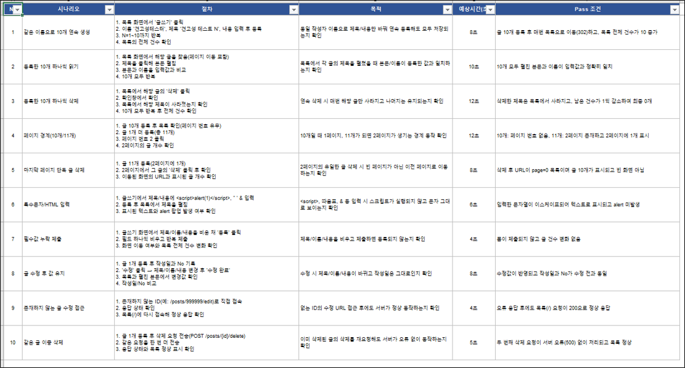

# 1. 테스트 세팅

<!-- 세팅한 테스트의 종류별 개수와 테스트 도구를 적으세요. 세팅하지 않은 테스트는 개수에 0을 적거나 행을 지우세요. -->

| 테스트 | 개수 | 테스트 도구 |
|---|:-:|---|
| Unit Test | 16개 | JUnit 5, AssertJ (`PlannerTest`, Spring 없이 경로 계산 로직만 검증) |
| Slice Test | 49개 | Spring Boot `@WebMvcTest`(컨트롤러 36개) · `@DataJpaTest`(리포지토리 13개), MockMvc, Mockito(`@MockitoBean`), JUnit 5, AssertJ, H2 |
| 통합 테스트 | 65개 | JUnit 5, Spring Boot Test(`@SpringBootTest`), MockMvc, AssertJ, 메모리 H2 |
| E2E 테스트 | 106개 | Playwright (Chromium) |
| Robustness 테스트 | 6개 | Playwright (`e2e/robustness`, 반복 실행 3개 + 동시 요청 3개) |
| Stress 테스트 | 5개 | JUnit 5, Spring Boot Test, MockMvc, `ExecutorService`(16~32개 스레드 동시 요청), 메모리 H2 |
| 성능 테스트 | 6개 | JUnit 5(`@Tag("performance")`), AssertJ, MockMvc (경로 계산 3개 + 주문 목록 조회 3개, 기준 시간 안에 끝나는지 확인) |
| Test Coverage | 97.0% | JaCoCo (라인 기준, Java 테스트 141개 측정. Playwright E2E·Robustness는 제외) |

 

## 테스트 시나리오

<!-- 아래 샘플 이미지를 팀이 제작한 테스트 시나리오 캡처로 교체하세요. 캡처는 presentation/assets/에 올리고 파일명을 맞추세요. -->

아래는 테스트 시나리오 샘플 입니다.

---

[← 목차](README.md) · [다음: Loop 설계 →](02-loop.md)
