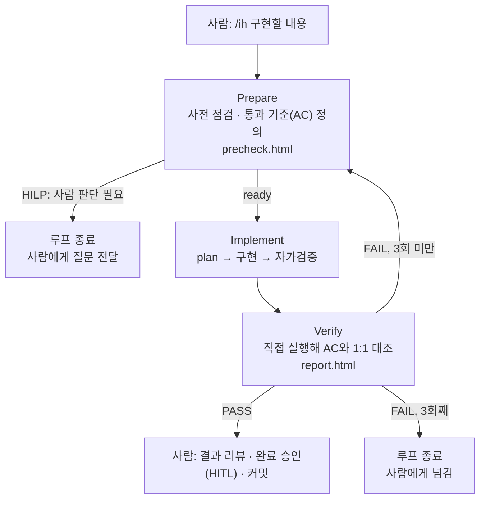

# 2. Loop 설계

Loop 설계는 이번 팀 프로젝트에서 가장 핵심이 되는 내용입니다.

이번 프로젝트에서는 구현 전에 점검하고, 구현 후에는 검증하여 리포트를 작성하는 자신만의 Loop를 각자 설계했습니다.

이 중 소개할 만한 좋은 Loop를 선정하여 소개합니다.

 

## 팀 Evidence 템플릿

<!-- 팀에서 협의한 Evidence 템플릿 2개를 소개하세요. -->
<!-- GitHub에서는 .html 파일이 화면으로 렌더링되지 않고 소스로 보입니다. 결과 화면을 캡처해서 presentation/assets/에 올리고 함께 보여주세요. -->

| 템플릿 | 사용 시점 | 링크 |
|---|---|---|
| precheck.html | 구현 전 | [precheck.html](../docs/loops/templates/precheck.html) |
| report.html | 구현 후 | [report.html](../docs/loops/templates/report.html) |

#### 팀 Loop 공통 뼈대

두 템플릿은 팀원이 공통으로 쓰는 `/ih` Loop의 산출물입니다. **준비(Prepare) → 구현(Implement) → 검증(Verify)** 을 서로 독립된 컨텍스트의 서브에이전트가 맡고, 검증이 실패하면 준비로 돌아갑니다.

| 단계 | 하는 일 | 증거 (템플릿) |
|---|---|---|
| Prepare | 요청의 의도와 근거 문서(PRD·INTENT)를 확인하고, 구현 전 기준선과 통과 기준(AC)을 정합니다. 사람이 결정할 일이면 구현하지 않고 멈춥니다 | `precheck.html` |
| Implement | 계획을 세우고 범위 안에서 구현한 뒤 자가검증합니다. 합격은 단정하지 않습니다 | 계획·구현 결과 (노트 또는 JSON) |
| Verify | 구현자의 주장을 믿지 않고 실제 코드·`git diff`·테스트 출력으로 AC를 하나씩 판정합니다 | `report.html` |

**실행 중에는 사람의 승인을 기다리지 않습니다.** 사람의 일은 시작 전(요청을 구체적으로 쓰기), HILP로 멈췄을 때(질문에 답하고 다시 실행), 끝난 뒤(통과하면 코드 리뷰·완료 승인(HITL)·커밋, 3회 실패하면 원인 판단)에 있습니다. 에이전트는 HITL 칸을 채우지 않고 커밋·푸시도 하지 않습니다.

| 설계 결정 | 이유 |
|---|---|
| 순서·피드백·종료는 워크플로 코드가 고정하고, 판단은 에이전트가 한다 | 흐름을 모델 판단에 맡기면 단계를 건너뛰거나 끝없이 돌 수 있습니다 |
| 구현자와 검증자를 분리한다 | 구현자가 자기 결과를 합격시키면 맹점이 같습니다 |
| 검증 실패 시 구현이 아니라 준비로 돌아간다 | 원인이 구현이 아니라 통과 기준·환경·범위에 있을 수 있습니다 |
| 재시도해도 통과 기준을 낮추지 않는다 | 기준을 완화하면 루프가 통과하기 쉬운 쪽으로 흐릅니다 |
| 반복은 최대 3회 | 무한 반복을 막는 안전장치이고, 넘으면 사람에게 넘깁니다 |

 

## Best Practice: Loop 설계

팀 프로젝트 중 각자 자신만의 Loop를 소개한 Markdown 페이지를 업로드했습니다. (경로 : `docs/loops/팀원이름/README.md`)

팀원이 서로의 Loop 중 괜찮다고 생각한 것을 골라 각자 작성했습니다. 각 블록의 **작성자**와 **소개 팀원**을 구분해 두었고, 팀원 글은 원문 그대로 모았습니다. (오재석의 Loop는 문형석·우주상 두 명이 골랐습니다.)

#### Best Practice 1 — 작성: 문형석

| 항목 | 내용 |
|---|---|
| 소개 팀원 | 오재석 |
| Loop 설명 링크 | [docs/loops/오재석/README.md](../docs/loops/오재석/README.md) |
| 좋았던 점 | **1. 검증이 실패하면 구현이 아니라 "준비 단계"로 돌아갑니다.** 실패 원인이 구현이 아니라 통과 기준·환경·범위에 있을 수 있기 때문이고, 같은 `precheck.html`을 갱신해 보완 이력을 남깁니다. 실제 첫 실행(F-01)에서 2라운드에 Prepare가 원인을 "구현 결함이 아니라 테스트 공백"으로 진단해 통과했습니다. **2. 루프 제어를 에이전트의 판단이 아니라 워크플로 코드가 고정합니다.** Verify가 `pass`라고 해도 `blocker`나 `fail`·`skip` 항목이 있거나, `src/main/`이 바뀌었는데 서버 재시작 증거가 없으면 워크플로가 통과로 인정하지 않습니다. 지침으로만 적어 두었을 때 에이전트가 건너뛴 문제를 코드로 막은 사례입니다. **3. 확인하지 못한 것과 비용을 표로 공개합니다.** "확인하지 못한 것"을 항목별로 상태(확인됨/부분 확인/미확인)와 함께 적었고, 첫 실행의 규모(에이전트 6개, 약 17분, 서브에이전트 토큰 약 41.7만)와 아직 실행해 보지 않은 경로(HILP 종료, `max-rounds` 종료)까지 기록했습니다. |

#### Best Practice 2 — 작성: 문형석

| 항목 | 내용 |
|---|---|
| 소개 팀원 | 우주상 |
| Loop 설명 링크 | [docs/loops/우주상/README.md](../docs/loops/우주상/README.md) |
| 좋았던 점 | **1. 기능을 5개 질문으로 L1~L3 등급으로 분류해 엄격함을 조절합니다.** 저장 데이터 변경, 되돌리기 어려운 동작, 기대 동작 미정, 영향 범위, 금액·권한·보안 여부를 묻고, 분류가 애매하면 한 등급 위로 올립니다. 특히 "되돌릴 수 없는 일"과 "기대 동작이 정해지지 않은 일"은 AI가 혼자 판단하면 안 되므로 바로 L3(사람이 결정)로 올립니다. **2. 사람이 개입하는 지점이 명확합니다.** 항상 거치는 두 게이트(① 구현 착수 승인, ② 완료 승인)에 더해, 범위 밖 수정이 필요할 때·되돌릴 수 없는 작업 직전·같은 원인으로 2회 연속 실패했을 때·설계 원칙을 어길 가능성이 있을 때는 멈추고 사람에게 묻도록 조건부 게이트를 정해 두었습니다. **3. 원칙 6가지가 설계 전체의 기준이 됩니다.** 증거 우선, 기준 먼저, 범위 고정, 위험에 비례, 되돌릴 수 없는 일은 사람이, 실패를 숨기지 않는다. 이 원칙에서 단계별 규칙과 실패 시 원인을 분류해 알맞은 단계로 되돌아가는 방식이 이끌려 나옵니다. |

#### Best Practice 3 — 작성: 오재석

| 항목 | 내용 |
|---|---|
| 소개 팀원 | 김현곤 |
| Loop 설명 링크 | [docs/loops/김현곤/README.md](../docs/loops/김현곤/README.md) |
| 좋았던 점 | **1. 사람과 에이전트의 역할이 한눈에 보입니다.** 흐름도를 사람/에이전트 영역으로 나눠 그렸고, 실행 전·HILP·통과 후·실패 후 등 시점별로 사람이 할 일을 표로 정리했습니다. 에이전트가 하지 않는 일(HITL 칸 작성, 커밋·푸시, 체크리스트 완화, 열린 질문 임의 결정)도 명시했습니다. **2. 구현자의 말을 믿지 않는 독립 검증입니다.** verify는 `git diff`와 직접 실행한 테스트 출력만 근거로 판정하고, 검증하지 못한 항목(`skip`)이 하나라도 있으면 FAIL로 처리합니다. 실패 이력은 `verify_feedback.md`에 덮어쓰지 않고 이어 써서 다음 회차가 가장 먼저 읽습니다. **3. 한계를 숨기지 않고 실제 사례로 밝혔습니다.** "발주사 필수 입력" 요청이 단위 테스트는 통과했지만 Playwright E2E 22개를 깨뜨렸고 `/ih`가 이를 잡지 못했다는 점을 기록해, 통과 조건에 E2E를 넣을지를 열린 질문으로 남겼습니다. |

#### Best Practice 4 — 작성: 김현곤

| 항목 | 내용 |
|---|---|
| 소개 팀원 | 문형석 |
| Loop 설명 링크 | [docs/loops/문형석/README.md](../docs/loops/문형석/README.md) |
| 좋았던 점 | **1. 적대적 검토:** 테스트가 통과해도 `git diff`를 반박하는 관점으로 다시 읽어 숨은 동작 변경을 찾고, 확인되면 FAIL로 처리합니다. 내 verify에는 이런 단계가 없습니다. **2. 기준선 대비 검증:** `cleanTest`로 결과 재사용 없이 새로 돌려 기준선과 비교하고, 동작을 고정하는 테스트가 없는 코드는 HITL로 멈춥니다. 내 verify는 `gradlew.bat test`만 돌립니다. **3. 같은 원인 2회 연속 실패 시 중단:** 한도(3회) 안이어도 사람에게 넘기고, 템플릿 준수도 기계적으로 검사합니다. 내 쪽은 이 중단 규칙을 강제하지 않습니다. |

#### Best Practice 5 — 작성: 우주상

| 항목 | 내용 |
|---|---|
| 소개 팀원 | 오재석 |
| Loop 설명 링크 | [docs/loops/오재석/README.md](../docs/loops/오재석/README.md) (PR #16) |
| 좋았던 점 | **1.** Verify가 "통과"라고 해도 워크플로가 `fail`, `skip`, `blocker`와 서버 재시작 증거를 코드로 다시 확인합니다. 에이전트의 말을 그대로 믿지 않고 통과를 판정합니다. **2.** 실제 실행(결함 4건 수정)에서 Verify가 "검증하지 못함"을 숨기지 않고 실패로 돌려보냈고, Prepare가 원인을 구현이 아니라 테스트 공백으로 구분해 2라운드 만에 통과했습니다. 피드백 루프가 설계대로 도는 것을 보여 줬습니다. **3.** 실행에서 드러난 약점(Verify가 서버 재시작을 생략한 것)을 숨기지 않고 규칙으로 보강했습니다. 확인한 것과 못 한 것을 구분해 기록했고, 설계 결정마다 이유를 적었습니다. |

#### 다른 팀원 설계안에서 가져올 만한 아이디어

아래는 설계안에 담긴 아이디어입니다.

| 아이디어 | 내용 | 출처 |
|---|---|---|
| 위험에 비례하는 엄격함 | 5개 질문(저장 데이터 변경, 되돌리기 어려운 동작, 기대 동작 미정, 영향 범위, 금액·권한·보안)으로 기능을 L1~L3으로 분류하고, 애매하면 한 등급 위로 올립니다. 되돌릴 수 없는 일과 기대 동작이 정해지지 않은 일은 바로 L3(사람이 결정)입니다 | [우주상](../docs/loops/우주상/README.md) |
| 조건부 사람 게이트 | 항상 거치는 두 게이트(구현 착수 승인, 완료 승인)에 더해, 범위 밖 수정·되돌릴 수 없는 작업 직전·같은 원인 2회 연속 실패·설계 원칙 위반 가능성이 있을 때 멈추고 묻습니다 | [우주상](../docs/loops/우주상/README.md) |
| 실패 원인별 복귀 단계 | 실패를 구현 오류·검증 방법 오류·환경 문제·기준 부적절 등으로 분류해, 원인에 맞는 단계로 되돌립니다 | [우주상](../docs/loops/우주상/README.md) |
| 원칙 6가지 | 증거 우선, 기준 먼저, 범위 고정, 위험에 비례, 되돌릴 수 없는 일은 사람이, 실패를 숨기지 않는다. 단계별 규칙이 이 원칙에서 나옵니다 | [우주상](../docs/loops/우주상/README.md) |
| 적대적 검토 · 테스트 안전망 점검 | 테스트가 통과해도 동작이 바뀐 곳이 없는지 반박하는 관점으로 `git diff`를 한 번 더 읽고, 동작을 고정해 주는 테스트가 없는 코드는 바로 바꾸지 않고 사람에게 넘깁니다 | [문형석](../docs/loops/문형석/README.md) |

 

## Loop를 돌리며 느꼈던 점

팀원별로 작성한 내용을 원문 그대로 구분해 모았습니다.

### 김현곤

#### 좋았던 점

- 기준을 잘 만들어 주면 Agent가 정말로 많은 일을 할 수 있다는 사실에 많이 놀랐습니다.

#### 아쉬웠던 점

- 기준을 웬만큼 잘 만들지 않으면 Agent가 내부적으로 어떤 일을 하는지 알기가 어렵습니다.
- 자동으로 하는 일이 많아지는 만큼 인지부채가 쌓여서 결국 의존하게 될 것 같은 막연한 불안감이 있습니다.

#### 문제와 개선

| 문제 | 원인 | 어떻게 개선했나요? |
|---|---|---|
| 통제: Agent 스스로 판단하고 하는 일이 많아지고, Evidence를 만들지만 리뷰어 입장에서 컨텍스트 이해에 대한 속도감이 다르고 무엇보다 리뷰 볼륨의 사이즈가 압도적으로 많아지는 이슈 | 자동화시키는 업무 단위가 너무 크거나 지시하는 내용이 모호할 경우 AI가 독자적으로 판단하는 경우가 많음 | Loop 설계 시 Plan 단계를 넣어서 최초 Agent 스스로 계획 후 변경이 예상되는 범위가 발견되는 경우 리뷰어의 확인을 받도록 HILP 단계를 추가함 |

### 문형석

`/refactoring` Loop(prepare → implement → verify)를 설계해 실행해 보았고, 필요 납기일(TASK-005, PR #23)은 같은 구조(사전 점검 → 구현 → 검증 리포트)를 수동으로 따라 진행했습니다. (증거: [report.html](../docs/evidence/문형석/TASK-005-required-delivery-date/report.html))

#### 좋았던 점

- **"끝났다"의 기준을 구현 전에 정했습니다.** 통과 기준을 먼저 적고(AC-1~9) 구현 뒤 기준마다 명령과 결과를 표로 대조해서 "무엇을 확인했는지"가 남았습니다.
- **새 테스트가 기능이 없는 옛 코드에서는 실패하는지 확인했습니다.** `main`을 별도 폴더로 받아 새 테스트만 복사해 실행하니 JUnit 4개·E2E 6개가 모두 실패해서, 통과만 하는 테스트가 아님을 증거로 남길 수 있었습니다.
- **증거 문서 덕분에 리뷰가 빨라졌습니다.** PR #23의 리뷰어가 report와 스크린샷으로 확인하고 "증거 폴더에 개인 경로나 계정명이 없다"는 점까지 점검했습니다.

#### 아쉬웠던 점

- **내가 설계한 `/refactoring`은 끝까지 도는 경험을 못 했습니다.** 첫 실행이 대상이 불분명한 상태에서 `main` 브랜치였기 때문에 prepare가 사람에게 넘기며(HITL) 종료됐고, implement·verify 단계는 실제로 실행해 보지 못했습니다.
- **precheck에 적은 내용을 실제로 확인하지 않았습니다.** 위험표에 "소수는 서버가 검증"이라고 적었지만 서버는 검증하지 않았고, 리뷰어가 로컬에서 재현해 알려 주었습니다(아래 표 첫 행).

#### 문제와 개선

| 문제 | 원인 | 어떻게 개선했나요? |
|---|---|---|
| 서버가 `requiredDays`로 `5.5`를 `5`로, `"10"`을 `10`으로 조용히 바꿔 저장했습니다 (PR #23 리뷰에서 발견) | 화면에서 소수를 막는 것만 테스트했고 API를 직접 호출해 보지 않았는데, precheck에는 "서버가 검증"이라고 적었습니다 | 요청 값을 `JsonNode`로 받아 정수만 허용(소수·문자열은 400)하고, 경계 테스트 3개와 API 케이스(DLN-06)를 추가했습니다. 새 테스트가 수정 전 컨트롤러에서 실패하는 것을 확인했고 precheck·report 문구도 정정했습니다 |
| 전체 E2E를 다시 돌리다 서버 연결 오류(`ERR_CONNECTION_REFUSED`)로 12건이 실패했습니다 | 앞서 시작한 백그라운드 Playwright 실행이 끝나기 전에 새로 시작해서 같은 포트(18080)와 서버를 겹쳐 썼습니다 | 겹치지 않게 순차로 다시 실행해 통과(89 통과·0 실패, 반복 60/60)를 확인했고, 보고서 5장에 이 일시 실패를 사실대로 적었습니다 |
| JUnit 결과 XML에 PC 사용자 계정 이름이 들어갔습니다 | JUnit이 실행 정보를 "started by 계정" 형태로 기록합니다 | 커밋 전에 계정 이름을 치환하고, 증거 폴더 전체에서 사용자 이름·`Users` 경로가 0건인지 검색해 확인했습니다 |
| 다른 팀원 PR을 리뷰하는 사이 작성자가 새 커밋을 올렸습니다 (PR #25) | 리뷰한 시점과 코멘트를 게시하는 시점 사이에 PR의 head 커밋이 바뀌었습니다 | 게시 직전에 head를 다시 확인했고, 코멘트 맨 위에 "리뷰 기준 커밋 `4bee1f4`, 이후 병합 후 테스트는 아직 실행하지 않음"을 적었습니다. 이후 최신 커밋(`cda096c`)을 다시 받아 재검증한 뒤 승인했습니다 |

### 오재석

F-01 결함 수정·F-02 계정 관리·TASK-006 고객사 이름 입력(PR #24)을 Loop로 진행하며 느낀 점입니다. (증거: [report.html](../docs/evidence/오재석/TASK-006-customer-name-input/report.html))

#### 좋았던 점

- **검증이 내 구현을 막아 줬습니다.** F-01 1라운드에서 Verify가 검증하지 못한 항목을 실패로 돌려보냈고, 2라운드에 통과했습니다.
- **증거 문서 덕분에 리뷰가 빨라졌습니다.** PR #24 리뷰어가 report의 수치를 바로 확인했습니다.

#### 아쉬웠던 점

- **설계가 끝나도 첫 실행에서 구멍이 나옵니다.** HILP·`max-rounds` 종료는 한 번도 실행해 보지 못했습니다.
- **느리고 비쌉니다.** F-01에 약 17분, 서브에이전트 토큰 약 41.7만이 들었습니다.

#### 문제와 개선

| 문제 | 원인 | 어떻게 개선했나요? |
|---|---|---|
| 코드가 바뀌었는데 서버 재시작 없이 E2E를 돌렸습니다 (F-01) | 재시작을 지침으로만 적어 에이전트가 건너뛰었습니다 | 워크플로 코드가 재시작 증거가 없으면 통과로 인정하지 않게 했습니다 |
| 리뷰 승인 뒤 다른 PR이 먼저 병합되어 충돌이 났습니다 (TASK-006) | 다른 기능이 같은 파일과 PRD·INTENT를 함께 바꿨습니다 | 두 기능을 모두 남기며 병합하고 병합 상태에서 전체 회귀를 다시 돌렸습니다 |

### 우주상

설계한 Loop를 직접 사용해 보니 두 가지 장점이 있었습니다.

#### 좋았던 점

- 반복 작업을 자동화해 공수를 크게 줄일 수 있었습니다.
- 진행 과정을 문서로 남기기 때문에 산출물이 꾸준히 쌓였습니다.

#### 아쉬웠던 점

- Loop의 설계가 깊어질수록 실행 시간이 길어집니다.
- 산출물의 분량이 늘어나면 가독성이 떨어질 수 있습니다.

---

[← 이전: 테스트 세팅](01-test.md) · [목차](README.md) · [다음: 기능 추가 미션 동작 영상 →](03-missions.md)
