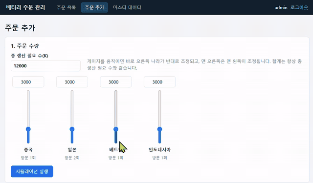
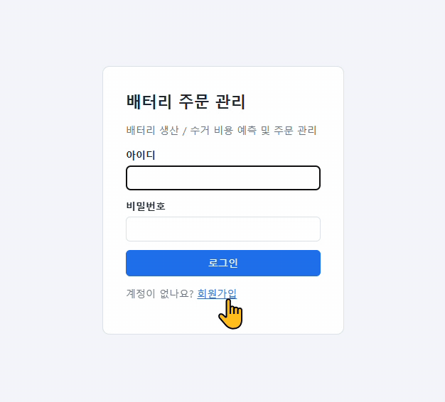

# 3. 기능 추가 미션 동작 영상

기능 추가를 한 결과 시연 영상을 살펴봅니다.

GIF는 화면에서 바로 재생되지만, mp4는 다운로드한 후 별도의 플레이어로 실행해야 합니다.

GIF 또는 mp4 영상을 첨부해 주세요.

<!-- 기능 구현한 동작 영상(GIF), 각 길이는 30초 이내, 폭 640px(손바닥 크기 수준) 크기를 권장합니다. -->
<!-- 기능별로 아래 블록(제목 + GIF + mp4 링크)을 복사해서 기능명과 파일명만 바꾸세요. -->

 

## 기능 1. 지도 탐색 (예시)

▶ [feature1.mp4](assets/feature1.mp4)

 

## 기능 2. 회원 가입 (예시)

▶ [feature2.mp4](assets/feature2.mp4)

---

[← 이전: Loop 설계](02-loop.md) · [목차](README.md) · [다음: PR & 코드리뷰 →](04-review.md)
