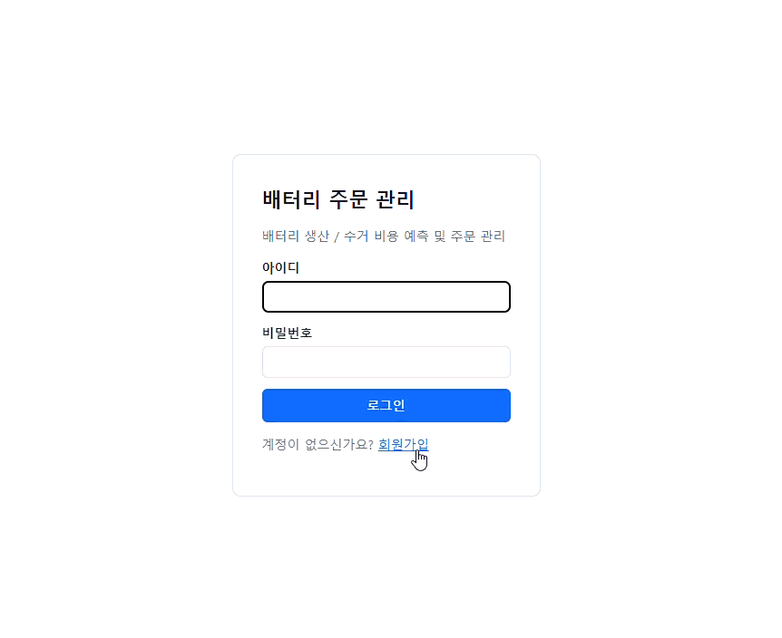
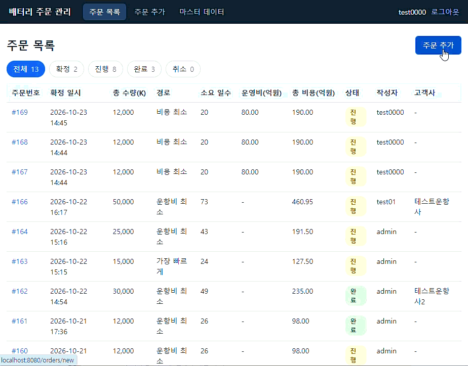
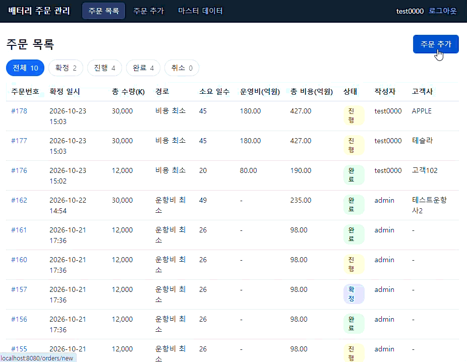
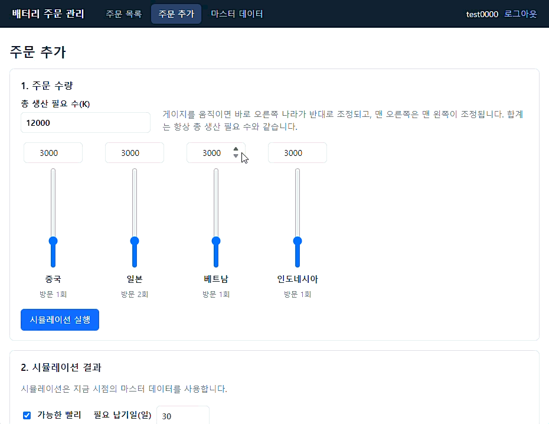

# 3. 기능 추가 미션 동작 영상

기능 추가를 한 결과 시연 영상을 살펴봅니다.

GIF는 화면에서 바로 재생됩니다.

 

## 기능 1. 사용자 추가 기능

 

## 기능 2. 필요 납기일 지정 기능

 

## 기능 3. 고객사 이름 기능

 

## 기능 4. 공장 운영비 추가 기능

---

[← 이전: Loop 설계](02-loop.md) · [목차](README.md) · [다음: PR & 코드리뷰 →](04-review.md)
